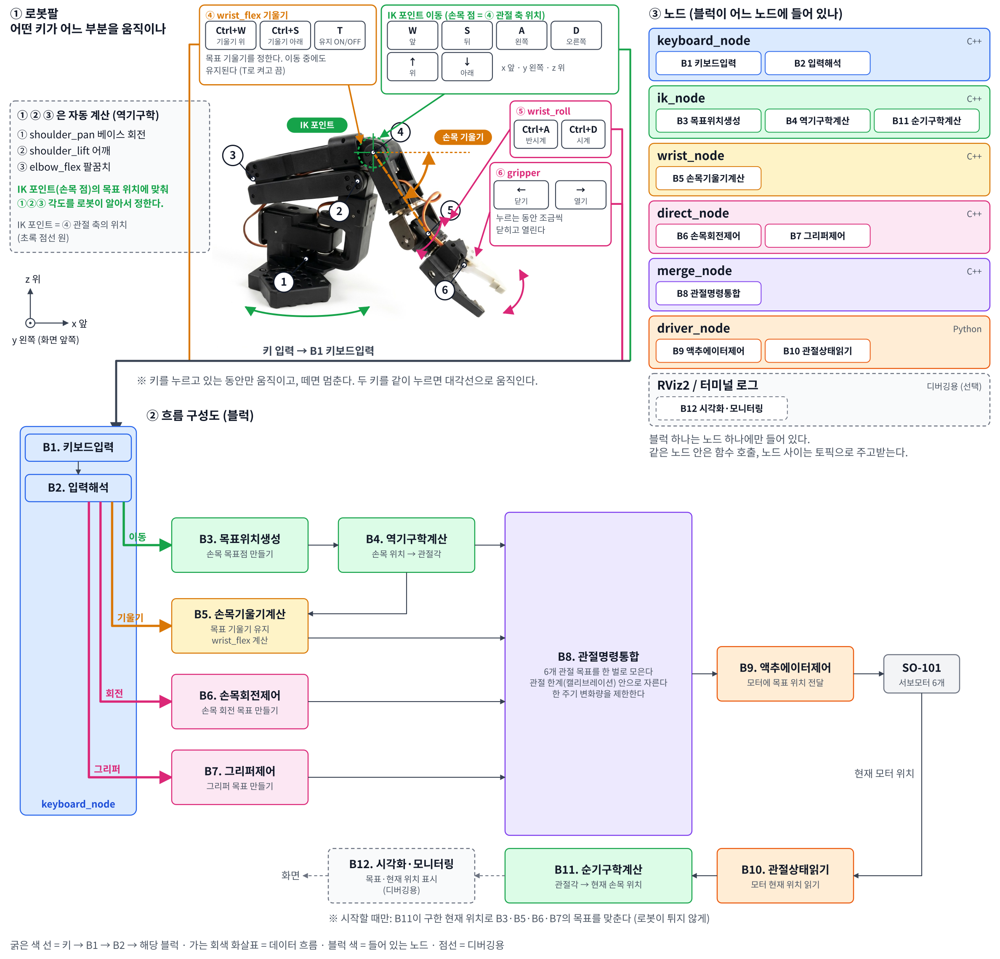

# SO-101 키보드 손목 위치 제어 로봇팔 (ROS 2)

> 기말프로젝트 — **주제선정** (이 문서) · [개념설계(블럭도)](docs/concept-design.md)

---

## 1. 작품명

**키보드로 손목 위치(x, y, z)를 정하고 손목 기울기를 유지하며 움직이는 SO-101 로봇팔**
— 역기구학(IK) 기반 ROS 2(C++) 텔레오퍼레이션

---

## 2. 작품설명

LeRobot SO-101 로봇팔을 키보드로 조종한다.
키로 **손목(아래에서 4번째 관절, wrist_flex 축)이 갈 위치**를 정하면 로봇이 관절 각도를 역기구학으로 계산해서 움직인다.
물체를 잡을 **손목 기울기**는 Ctrl+W/S 키로 정하고, 이 기울기는 손목이 이동하는 동안에도 유지된다. (켜고 끄는 옵션)



위 그림 설명: ① 어떤 키가 어느 부분을 움직이는지, ② 키 입력이 어떤 블럭을 거쳐 모터까지 가는지, ③ 블럭이 어느 노드에 들어 있는지.

- 키를 누르고 있는 동안만 움직이고, 떼면 그 자세로 멈춘다. 두 키를 같이 누르면 대각선으로 움직인다.
- 손목 위아래(wrist_flex) 각도 = 목표 기울기 − (어깨 + 팔꿈치). `T`로 기울기 유지를 끄면 목표를 그 관절 각도로 쓴다.
- 관절 한계를 넘는 목표는 무시한다. 기울기를 못 만드는 위치에서는 위치 이동이 우선이고 손목은 한계값에 멈춘다.
- 노드 6개를 토픽으로 연결한다. 드라이버만 파이썬이고 나머지는 C++(rclcpp)이다. launch 파일과 파라미터 파일(`controller_params.yaml`)로 실행한다.
- 실행 환경: WSL2 Ubuntu + ROS 2 + **WSLg(필수)**. WSLg가 있어야 키 입력 창이 Windows 화면에 뜨고, 그 창으로 키를 받을 수 있다.
- 키 입력 창: keyboard_node가 GLFW로 작은 창을 띄운다. WSLg 덕분에 이 창이 Windows 화면에 일반 창처럼 뜨고, 창을 클릭해 포커스를 준 상태에서 누른 키만 읽는다. 키를 누르면 true, 떼면 false로 `key_state`에 기록하고, 창이 포커스를 잃으면 모든 키를 떼진 것으로 처리해 로봇을 멈춘다.

### USB 연결 (WSL2 + usbipd-win)

로봇의 USB를 WSL로 넘겨야 `/dev/ttyACM*`가 생긴다. 한 번 설치하고 처음 한 번 `bind` 하면, 이후에는 `attach`만 하면 된다.

> 📦 **Windows 준비물(usbipd-win 설치 파일)과 자세한 설명은 [`../so101-windows-setup`](../so101-windows-setup)** 에 있다. clone 없이 Windows에서 바로 받아 설치할 수 있다.

1. **(처음 한 번) Windows에 usbipd-win 설치** — PowerShell
   ```powershell
   winget install --interactive --exact dorssel.usbipd-win
   ```
2. **WSL 터미널을 하나 열어 둔다.** (WSL이 켜져 있어야 attach가 된다)
3. **장치 확인** — PowerShell(관리자)
   ```powershell
   usbipd list
   ```
   로봇 컨트롤러의 BUSID(예: `4-4`)를 확인한다.
4. **(처음 한 번) 공유 설정** — PowerShell(관리자)
   ```powershell
   usbipd bind --busid 4-4
   ```
5. **WSL로 연결** — PowerShell (관리자 권한 필요 없음)
   ```powershell
   usbipd attach --wsl --busid 4-4
   ```
   로봇을 다시 꽂거나 PC를 재부팅하면 이 단계를 다시 한다.
6. **WSL에서 확인**
   ```bash
   ls /dev/ttyACM*        # 예: /dev/ttyACM0
   sudo chmod 666 /dev/ttyACM0   # permission denied가 나면
   ```
7. **연결 해제** (필요할 때) — PowerShell
   ```powershell
   usbipd detach --busid 4-4
   ```

※ attach 중에는 Windows에서 그 장치를 쓸 수 없다.
※ `attach`가 실패하면 PowerShell에서 `wsl --shutdown` 후 WSL을 다시 열고 다시 시도한다.

---

## 3. 선정이유

- 사람은 관절 각도가 아니라 "앞으로, 위로"처럼 **위치로 생각**한다. 위치만 정하면 각도는 로봇이 계산하게 하고 싶었다.
- 위치는 IK가, **손목 기울기는 사람이 따로** 정해서 물체를 원하는 각도로 잡을 수 있다.
- 리더암 없이 **키보드만으로** 조종할 수 있다.
- 노드·토픽·파라미터·launch 등 **ROS 2 수업 내용**을 실제 로봇에 C++로 적용할 수 있다.

---

## 4. 필요기술

| 분야 | 필요한 기술 |
|---|---|
| ROS 2 (C++) | 노드, 토픽, 파라미터, launch, rclcpp, colcon |
| 로봇 기구학 | 순기구학(FK), 역기구학(IK), 코사인 법칙, 좌표계(x 앞 / y 왼쪽 / z 위) |
| 로봇 하드웨어 | LeRobot SO-101 파이썬 API, STS3215 서보, 캘리브레이션(관절 한계) |
| 키보드 입력 | GLFW 창으로 키 상태 읽기 (누름/뗌, 동시 입력, Ctrl 조합). 창 표시는 WSLg 필수 |
| 제어 | 작업영역·관절 한계 제한, 변화량 제한, 시작할 때 현재 위치로 목표 맞추기 |
| 개발 환경 | WSL2 Ubuntu, WSLg, usbipd-win, Git/GitHub |

---

## 5. 설치 · 실행

코드(ROS 2 패키지)는 발표자료와 분리해서 옆 폴더에 있다.

- **ROS 2 패키지 · 설치 · 실행 방법**: [`../so101-ros2-ws`](../so101-ros2-ws)
- **Windows 준비 (usbipd-win 설치 파일)**: [`../so101-windows-setup`](../so101-windows-setup)

---

## 정리

- **작품**: 키보드로 SO-101 손목 위치(x, y, z)를 움직이면 로봇이 역기구학으로 관절각을 계산해서 따라가는 ROS 2 텔레오퍼레이션
- **조작**: `WASD`(앞뒤·좌우), `↑↓`(위아래), `Ctrl+W/S`(목표 기울기), `Ctrl+A/D`(손목 회전), `←→`(그리퍼), `T`(기울기 유지 켜기/끄기)
- **구조**: 노드 6개(키 입력, 역기구학, 손목 유지, 직접 제어, 취합, 드라이버), 드라이버만 파이썬
