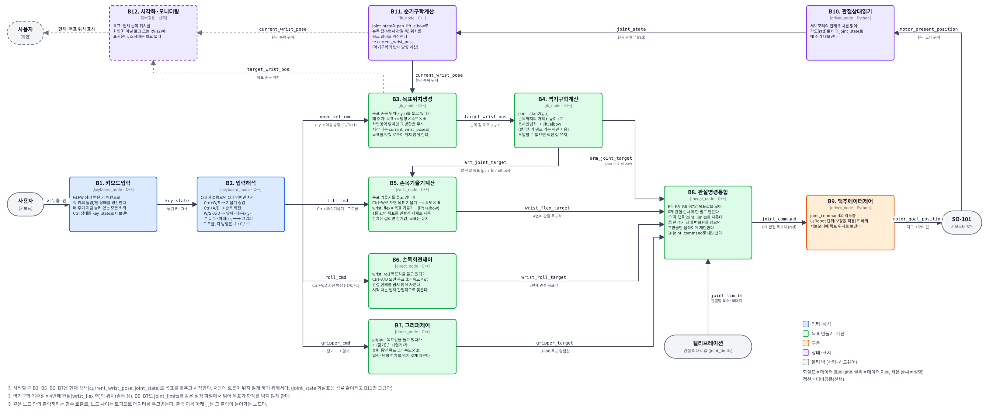
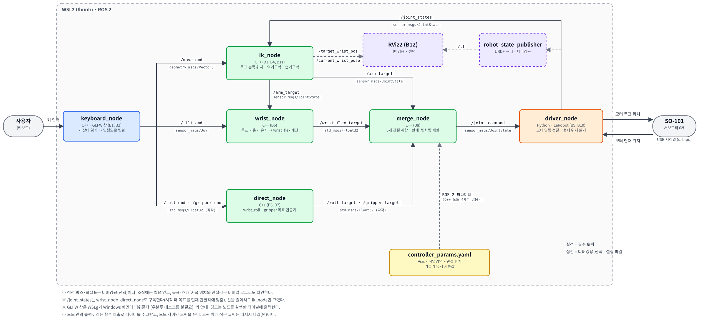

# 개념설계

> 기말프로젝트 — **개념설계** · [주제선정(README)](../README.md)

작품: **키보드로 손목 위치(x, y, z)를 정하고 손목 기울기를 유지하며 움직이는 SO-101 로봇팔 (ROS 2)**

---

## 1. 세부기능 정의

작품을 **12개 블럭**으로 나눴다. 블럭 하나는 노드 하나에만 들어간다.

| 블럭 | 기능 이름 | 하는 일 | 노드 |
|---|---|---|---|
| B1 | 키보드입력 | GLFW 창(WSLg로 Windows에 표시)에서 눌려 있는 키와 Ctrl 상태를 읽는다. 창이 포커스를 잃으면 모든 키를 뗀 것으로 처리한다 | `keyboard_node` |
| B2 | 입력해석 | 키를 명령(이동, 기울기, 회전, 그리퍼)으로 바꾼다. Ctrl 조합을 먼저 가른다 | `keyboard_node` |
| B3 | 목표위치생성 | 이동 방향을 쌓아서 손목 목표점(x,y,z)을 만든다. 작업영역 밖이면 무시 | `ik_node` |
| B4 | 역기구학계산 | 목표점 → pan / lift / elbow 각도 | `ik_node` |
| B5 | 손목기울기계산 | `wrist_flex = 목표 기울기 − (lift + elbow)` | `wrist_node` |
| B6 | 손목회전제어 | Ctrl+A/D로 wrist_roll 목표각을 만든다 | `direct_node` |
| B7 | 그리퍼제어 | ←→로 그리퍼 목표값을 만든다 | `direct_node` |
| B8 | 관절명령통합 | 6개 관절 목표를 모아 관절 한계·최대 변화량을 제한한다 | `merge_node` |
| B9 | 액추에이터제어 | 관절 명령을 모터 단위로 바꿔 서보모터에 보낸다 | `driver_node` |
| B10 | 관절상태읽기 | 서보모터의 현재 위치를 관절각으로 읽는다 | `driver_node` |
| B11 | 순기구학계산 | 현재 관절각 → 손목 점의 현재 위치 | `ik_node` |
| B12 | 시각화·모니터링 | 목표·현재 손목 위치를 표시한다 (**디버깅용, 선택**) | RViz2 / 로그 |

블럭 밖: 사용자(키보드), SO-101 서보모터 6개, 사용자(화면), 캘리브레이션(관절 최대각 값)

---

## 2. 전체 블럭도

- 화살표 = 데이터 흐름 방향, 굵은 글씨 = 데이터 이름, 작은 글씨 = 값의 설명
- 블럭 이름 아래 `[ ]` = 들어 있는 노드, **점선 = 디버깅용(선택)**
- 현재 상태(B10, B11)는 시작할 때 B3·B5·B6·B7이 목표를 현재 위치에 맞추는 데와 화면 표시에만 쓴다.

---

## 3. 블럭별 입력 · 출력

| 블럭 | 입력 (어디서) | 출력 (어디로) |
|---|---|---|
| B1 | 키 누름·뗌 (사용자) | `key_state` → B2 |
| B2 | `key_state` (B1) | `move_vel_cmd` → B3 / `tilt_cmd` → B5 / `roll_cmd` → B6 / `gripper_cmd` → B7 |
| B3 | `move_vel_cmd` (B2), 시작 때 `current_wrist_pose` (B11) | `target_wrist_pos` → B4, B12 |
| B4 | `target_wrist_pos` (B3) | `arm_joint_target` → B5, B8 |
| B5 | `tilt_cmd` (B2), `arm_joint_target` (B4), 시작 때 `joint_state` (B10) | `wrist_flex_target` → B8 |
| B6 | `roll_cmd` (B2), 시작 때 `joint_state` (B10) | `wrist_roll_target` → B8 |
| B7 | `gripper_cmd` (B2), 시작 때 `joint_state` (B10) | `gripper_target` → B8 |
| B8 | `arm_joint_target` (B4), `wrist_flex_target` (B5), `wrist_roll_target` (B6), `gripper_target` (B7), `joint_limits` (캘리브레이션) | `joint_command` → B9 |
| B9 | `joint_command` (B8) | `motor_goal_position` → 서보모터 |
| B10 | `motor_present_position` (서보모터) | `joint_state` → B11 (시작 때 B5, B6, B7) |
| B11 | `joint_state` (B10) | `current_wrist_pose` → B3, B12 |
| B12 | `target_wrist_pos` (B3), `current_wrist_pose` (B11) | 현재·목표 위치 표시 (화면) |

---

## 4. 데이터 정의

좌표계는 로봇 베이스 기준 x = 앞, y = 왼쪽, z = 위. 위치는 m, 각도는 rad.

| 데이터 이름 | 내용 | 값 |
|---|---|---|
| `key_state` | 눌린 키 목록 + Ctrl 상태 | 키 이름 목록 |
| `move_vel_cmd` | 손목 이동 방향 (W/S=x, A/D=y, ↑↓=z) | (x, y, z) 각각 −1/0/+1 |
| `tilt_cmd` | 목표 기울기 증감(Ctrl+W/S), 기울기 유지 토글(T) | −1/0/+1, T 눌림 |
| `roll_cmd` | 손목 회전 방향 (Ctrl+A 반시계, Ctrl+D 시계) | −1/0/+1 |
| `gripper_cmd` | 그리퍼 방향 (← 닫기, → 열기) | −1/0/+1 |
| `target_wrist_pos` | 손목 점 목표 위치 | (x, y, z) m |
| `current_wrist_pose` | 손목 점 현재 위치 | (x, y, z) m |
| `arm_joint_target` | IK 결과 (pan, lift, elbow) | rad |
| `wrist_flex_target` | 손목 위아래 관절 목표각 | rad |
| `wrist_roll_target` | 손목 회전 목표각 | rad |
| `gripper_target` | 그리퍼 목표 열림값 | 0 ~ 100 |
| `joint_limits` | 관절별 최소·최대각 | rad |
| `joint_command` | 6개 관절 최종 목표 (한계·변화량 제한 후) | rad |
| `motor_goal_position` | 모터 목표 위치 | 모터 값 |
| `motor_present_position` | 모터 현재 위치 | 모터 값 |
| `joint_state` | 6개 관절 현재각 | rad |

---

## 5. ROS 2 구성

실선 = 필수 토픽, 점선 = 디버깅용(선택)·설정 파일. 같은 노드 안의 블럭끼리는 함수 호출, 노드 사이는 토픽으로 데이터를 주고받는다.

| 노드 | 언어 | 블럭 | 구독 | 발행 |
|---|---|---|---|---|
| `keyboard_node` | C++ | B1, B2 | (키보드) | `/move_cmd`, `/tilt_cmd`, `/roll_cmd`, `/gripper_cmd` |
| `ik_node` | C++ | B3, B4, B11 | `/move_cmd`, `/joint_states` | `/arm_target` |
| `wrist_node` | C++ | B5 | `/tilt_cmd`, `/arm_target`, `/joint_states`(시작 때) | `/wrist_flex_target` |
| `direct_node` | C++ | B6, B7 | `/roll_cmd`, `/gripper_cmd`, `/joint_states`(시작 때) | `/roll_target`, `/gripper_target` |
| `merge_node` | C++ | B8 | `/arm_target`, `/wrist_flex_target`, `/roll_target`, `/gripper_target` | `/joint_command` |
| `driver_node` | Python | B9, B10 | `/joint_command` | `/joint_states` |

모든 C++ 노드는 `controller_params.yaml`에서 이동 속도, 작업영역, 관절 한계, 기울기 유지 기본값을 읽는다.

### 역기구학계산(B4) 순서

IK 기준점은 4번째 관절(wrist_flex 축)의 위치(손목 점)다.

1. `pan = atan2(y, x)`, 수평 거리 `r = √(x² + y²)`
2. (r, z) 평면에서 어깨–팔꿈치 2링크를 코사인 법칙으로 풀어 `lift`, `elbow`를 구한다. (팔꿈치가 위로 가는 해만 사용)
3. 닿지 않으면 직전 값을 유지한다.

이어서 B5가 `wrist_flex = 목표 기울기 − (lift + elbow)`를 계산한다. 관절 한계에 걸리면 한계값에서 멈추고, 목표 기울기는 그대로 둔다.

---

## 정리

- **12개 블럭**: 키보드입력, 입력해석, 목표위치생성, 역기구학계산, 손목기울기계산, 손목회전제어, 그리퍼제어, 관절명령통합, 액추에이터제어, 관절상태읽기, 순기구학계산, 시각화·모니터링(디버깅용)
- **흐름**: 키 입력 → 명령 해석 → 목표 위치 → 역기구학 → 손목 기울기 계산 → 관절 명령 통합 → 모터. 현재 상태는 시작할 때 목표를 맞추는 데와 화면 표시에만 쓴다.
- **노드 6개**에 블럭을 나눠 담고(블럭 하나는 노드 하나), 토픽으로 연결한다. 드라이버만 파이썬이다.
