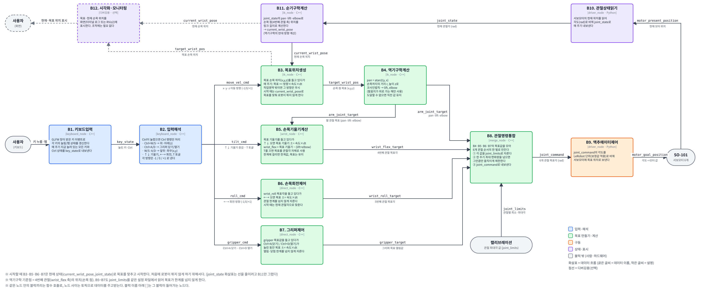
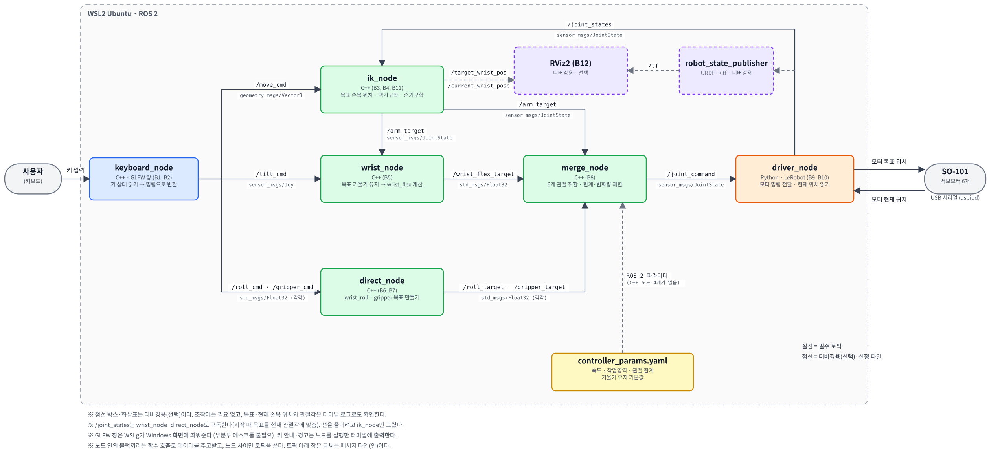

# 개념설계

> 기말프로젝트 — **개념설계** · [주제선정(README)으로 돌아가기](../README.md)

작품: **키보드로 손목 위치(x, y, z)를 정하고 손목 기울기를 유지하며 움직이는 SO-101 로봇팔 (ROS 2)**

---

## 1. 세부기능 정의

작품을 **12개 기능(블럭)** 으로 나눴다. 블럭 이름은 그 블럭이 하는 일의 이름이다. 블럭 하나는 노드 하나에만 들어간다.

| 블럭 | 기능 이름 | 하는 일 | 들어 있는 노드 |
|---|---|---|---|
| B1 | 키보드입력 | GLFW 창에서 지금 눌려 있는 키와 Ctrl 상태를 읽는다 (누름/뗌 둘 다) | `keyboard_node` |
| B2 | 입력해석 | 눌린 키를 명령으로 바꾼다 (이동 방향, 기울기, 회전, 그리퍼). Ctrl 조합을 먼저 가른다 | `keyboard_node` |
| B3 | 목표위치생성 | 이동 방향을 쌓아서 손목 목표점(x,y,z)을 만든다. 작업영역 밖이면 무시한다 | `ik_node` |
| B4 | 역기구학계산 | 목표점 → shoulder_pan / shoulder_lift / elbow_flex 각도 계산 | `ik_node` |
| B5 | 손목기울기계산 | 목표 기울기를 들고 있다가 `wrist_flex = 목표 기울기 − (lift + elbow)` 계산 | `wrist_node` |
| B6 | 손목회전제어 | ←→로 wrist_roll 목표각을 만든다 | `direct_node` |
| B7 | 그리퍼제어 | Ctrl+A/D로 그리퍼 목표값을 만든다 | `direct_node` |
| B8 | 관절명령통합 | 6개 관절 목표를 한 벌로 모으고, 관절 한계와 한 주기 최대 변화량을 제한한다 | `merge_node` |
| B9 | 액추에이터제어 | 관절 명령을 LeRobot 단위로 바꿔서 서보모터에 보낸다 | `driver_node` |
| B10 | 관절상태읽기 | 서보모터의 현재 위치를 읽어서 관절각으로 바꾼다 | `driver_node` |
| B11 | 순기구학계산 | 현재 관절각 → 손목 점의 현재 위치(x,y,z) 계산 | `ik_node` |
| B12 | 시각화·모니터링 | 목표·현재 손목 위치를 화면에 표시한다 (**디버깅용, 선택**) | RViz2 또는 터미널 로그 |

블럭 밖에 있는 것은 **사용자(키보드)**, **SO-101 서보모터 6개**, **사용자(화면)**, **캘리브레이션(관절 최대각 값)** 이다.

---

## 2. 전체 블럭도

- 네모 = 블럭 (제목은 기능 이름), 둥근 네모 = 블럭 밖(사람, 하드웨어)
- 화살표 = 데이터가 흐르는 방향, 화살표 위의 굵은 글씨 = 데이터 이름, 작은 글씨 = 그 값의 설명
- 블럭 이름 아래 `[ ]` = 그 블럭이 들어가는 노드
- **점선 = 디버깅용(선택)**: B12와 그리로 가는 화살표는 조작에는 필요 없다
- 벡터 원본: [block-diagram.svg](images/block-diagram.svg)

데이터 흐름은 크게 3개다.

1. **위치 흐름**: 키보드입력 → 입력해석 → 목표위치생성 → 역기구학계산 → 관절명령통합 → 액추에이터제어 → 서보모터
2. **기울기·회전·그리퍼 흐름**: 입력해석 → 손목기울기계산 / 손목회전제어 / 그리퍼제어 → 관절명령통합. (손목기울기계산은 역기구학계산이 낸 lift, elbow도 받는다)
3. **현재 상태 흐름**: 서보모터 → 관절상태읽기 → 순기구학계산 → 목표위치생성. 이 흐름은 **시작할 때 목표를 현재 위치에 맞추는 데**와 화면 표시에만 쓴다. 평소 위치 유지는 서보모터가 스스로 한다.

> 시작할 때 B3·B5·B6·B7은 현재 상태(`current_wrist_pose`, `joint_state`)로 목표를 맞추고 시작한다 (처음에 로봇이 튀지 않게). `joint_state` 화살표는 복잡해서 B11까지만 그렸다.

---

## 3. 블럭별 입력 · 출력

| 블럭 | 입력 데이터 (어디서 오나) | 출력 데이터 (어디로 가나) |
|---|---|---|
| B1 키보드입력 | 키 누름·뗌 (사용자) | `key_state` → B2 |
| B2 입력해석 | `key_state` (B1) | `move_vel_cmd` → B3 / `tilt_cmd` → B5 / `roll_cmd` → B6 / `gripper_cmd` → B7 |
| B3 목표위치생성 | `move_vel_cmd` (B2), *시작할 때* `current_wrist_pose` (B11) | `target_wrist_pos` → B4, B12 |
| B4 역기구학계산 | `target_wrist_pos` (B3) | `arm_joint_target` → B5, B8 |
| B5 손목기울기계산 | `tilt_cmd` (B2), `arm_joint_target` (B4), *시작할 때* `joint_state` (B10) | `wrist_flex_target` → B8 |
| B6 손목회전제어 | `roll_cmd` (B2), *시작할 때* `joint_state` (B10) | `wrist_roll_target` → B8 |
| B7 그리퍼제어 | `gripper_cmd` (B2), *시작할 때* `joint_state` (B10) | `gripper_target` → B8 |
| B8 관절명령통합 | `arm_joint_target` (B4), `wrist_flex_target` (B5), `wrist_roll_target` (B6), `gripper_target` (B7), `joint_limits` (캘리브레이션) | `joint_command` → B9 |
| B9 액추에이터제어 | `joint_command` (B8) | `motor_goal_position` → 서보모터 |
| B10 관절상태읽기 | `motor_present_position` (서보모터) | `joint_state` → B11 (시작할 때 B5, B6, B7도) |
| B11 순기구학계산 | `joint_state` (B10) | `current_wrist_pose` → B3, B12 |
| B12 시각화·모니터링 (디버깅용) | `target_wrist_pos` (B3), `current_wrist_pose` (B11) | 현재·목표 위치 표시 (사용자 화면) |

---

## 4. 데이터 정의

좌표계는 로봇 베이스 기준이다: **x = 앞, y = 왼쪽, z = 위** (ROS 관례). 위치는 m, 각도는 rad(내부 계산). LeRobot은 기본 단위가 도(degree)라서 B9/B10에서 변환한다.

| 데이터 이름 | 내용 | 값/단위 |
|---|---|---|
| `key_state` | 지금 눌려 있는 키 목록 + Ctrl 상태 | 키 이름 목록 (같은 노드 안이라 함수 호출로 전달) |
| `move_vel_cmd` | 손목 이동 방향 (W/S = x, A/D = y, Ctrl+W/S = z) | (x, y, z) 각각 −1 / 0 / +1 |
| `tilt_cmd` | 목표 기울기 증감 (↑↓), 기울기 유지 토글(T) | −1 / 0 / +1, T 눌림 |
| `roll_cmd` | 손목 회전 방향 (←→) | −1 / 0 / +1 |
| `gripper_cmd` | 그리퍼 방향 (Ctrl+A 닫기, Ctrl+D 열기) | −1(닫기) / 0 / +1(열기) |
| `current_wrist_pose` | 손목 점의 현재 위치 | (x, y, z) m |
| `target_wrist_pos` | 손목 점의 목표 위치 (작업영역 제한 후) | (x, y, z) m |
| `arm_joint_target` | IK 결과: shoulder_pan, shoulder_lift, elbow_flex | rad |
| `wrist_flex_target` | 손목 위아래 관절 목표각 | rad |
| `wrist_roll_target` | 손목 회전 목표각 (한 바퀴) | rad |
| `gripper_target` | 그리퍼 열림 목표 | 0 ~ 100 (임시) |
| `joint_limits` | 관절별 최소·최대각 (캘리브레이션 값) | rad |
| `joint_command` | 6개 관절 최종 목표 (한계·변화량 제한 후) | rad |
| `motor_goal_position` | 서보모터(STS3215) 목표 위치 | 모터 값 |
| `motor_present_position` | 서보모터 현재 위치 | 모터 값 |
| `joint_state` | 6개 관절의 현재 각도 | rad |

---

## 5. ROS 2 구성

### 노드와 블럭

- 실선 = 필수 토픽, 점선 = 디버깅용(선택)·설정 파일
- 같은 노드 안의 블럭끼리는 함수 호출로, 노드 사이만 토픽으로 데이터를 주고받는다.
- 벡터 원본: [node-graph.svg](images/node-graph.svg)

| 노드 | 언어 | 들어 있는 블럭 | 구독 (받는 것) | 발행 (보내는 것) |
|---|---|---|---|---|
| `keyboard_node` | C++ | B1, B2 | (키보드) | `/move_cmd`, `/tilt_cmd`, `/roll_cmd`, `/gripper_cmd` |
| `ik_node` | C++ | B3, B4, B11 | `/move_cmd`, `/joint_states` | `/arm_target` |
| `wrist_node` | C++ | B5 | `/tilt_cmd`, `/arm_target`, (시작 때) `/joint_states` | `/wrist_flex_target` |
| `direct_node` | C++ | B6, B7 | `/roll_cmd`, `/gripper_cmd`, (시작 때) `/joint_states` | `/roll_target`, `/gripper_target` |
| `merge_node` | C++ | B8 | `/arm_target`, `/wrist_flex_target`, `/roll_target`, `/gripper_target` | `/joint_command` |
| `driver_node` | Python (LeRobot) | B9, B10 | `/joint_command` | `/joint_states` |
| RViz2 + `robot_state_publisher` | - | B12 (디버깅용) | `/joint_states`, `/target_wrist_pos`, `/current_wrist_pose` | 화면 |

토픽과 메시지 타입(안, 구현하면서 바꿀 수 있다):

| 토픽 | 메시지 타입 | 내용 |
|---|---|---|
| `/move_cmd` | `geometry_msgs/Vector3` | `move_vel_cmd` |
| `/tilt_cmd` | `sensor_msgs/Joy` | `tilt_cmd` (axes = ↑↓, buttons = T) |
| `/roll_cmd`, `/gripper_cmd` | `std_msgs/Float32` | `roll_cmd`, `gripper_cmd` |
| `/arm_target` | `sensor_msgs/JointState` | `arm_joint_target` (pan, lift, elbow) |
| `/wrist_flex_target`, `/roll_target`, `/gripper_target` | `std_msgs/Float32` | 각 관절 목표 |
| `/joint_command` | `sensor_msgs/JointState` | `joint_command` |
| `/joint_states` | `sensor_msgs/JointState` | `joint_state` |
| `/target_wrist_pos`, `/current_wrist_pose` | `geometry_msgs/PointStamped` | 디버깅용 |

- 모든 C++ 노드는 `controller_params.yaml`에서 이동 속도, 작업영역, 관절 한계, 기울기 유지 기본값을 읽는다.
- 드라이버(`driver_node`)는 LeRobot SO-101 파이썬 API로 만든다. (공개된 C++ SO-101 드라이버 패키지가 있으면 나중에 바꿀 수 있다)
- 먼저 `driver_node` 없이 가짜 `/joint_states`로 IK만 확인하고, 그다음 실제 로봇을 붙인다.

### 역기구학계산(B4) 계산 순서

IK 기준점은 **4번째 관절(wrist_flex 축)의 위치(손목 점)** 다. 3D 시뮬레이션 없이 수식으로 바로 푼다.

1. 목표점 (x, y)로 베이스 회전각을 구한다: `pan = atan2(y, x)`, 수평 거리 `r = √(x² + y²)`
2. (r, z) 평면에서 어깨–팔꿈치 2링크 문제를 코사인 법칙으로 풀어서 `shoulder_lift`, `elbow_flex`를 구한다. 팔꿈치가 위로 가는 해만 쓴다. (SO-101 링크의 오프셋은 상수로 더한다)
3. 팔이 닿지 않으면 실패 처리 → 직전 값을 유지한다.

손목기울기계산(B5)은 이 결과로 `wrist_flex = 목표 기울기 − (shoulder_lift + elbow_flex)`를 계산한다. 기울기 유지를 끄면(T) 목표를 관절각 자체로 쓴다. 관절 한계에 걸리면 한계값에 멈추고 목표 기울기는 그대로 둔다.

링크 길이와 오프셋은 SO-101 URDF에서 읽어서 쓴다. 검증은 계산한 관절각을 순기구학(B11)에 넣어서 원래 목표점이 나오는지 비교한다. (C++ 단위 테스트)

---

## 6. 조작키 설계 메모

| 키 | 동작 | 블럭 |
|---|---|---|
| `W` / `S` | 앞 / 뒤 (x) | B2 → B3 |
| `A` / `D` | 왼쪽 / 오른쪽 (y) | B2 → B3 |
| `Ctrl + W` / `Ctrl + S` | 위 / 아래 (z) | B2 → B3 |
| `↑` / `↓` | 목표 기울기 | B2 → B5 |
| `←` / `→` | 손목 회전 (360°) | B2 → B6 |
| `Ctrl + A` / `Ctrl + D` | 그리퍼 닫기 / 열기 | B2 → B7 |
| `T` | 기울기 유지 켜기/끄기 | B2 → B5 |

- 키를 누르고 있는 동안만 움직이고 떼면 멈춘다. 정지 키는 없다. (서보가 자세를 유지한다. 토크를 끄면 팔이 처질 수 있어서 쓰지 않는다)
- 두 키를 같이 누르면 방향이 합쳐져서 대각선으로 움직인다.
- 키 입력은 GLFW 창으로 받는다. 터미널로는 키를 뗀 순간과 동시 입력을 알 수 없다.
- `Ctrl` 조합 해석은 `keyboard_node`(B2) 한 곳에서만 한다.

---

## 참고자료

- LeRobot SO-101 문서: <https://huggingface.co/docs/lerobot/so101>
- LeRobot 기구학(RobotKinematics, placo): <https://deepwiki.com/huggingface/lerobot/6.8-end-effector-control-and-kinematics>
- SO-ARM100/SO-101 URDF·모델: <https://github.com/TheRobotStudio/SO-ARM100>
- SO-101 ROS 2 워크스페이스: <https://so101-ros2.readthedocs.io>
- GLFW 키 입력 가이드: <https://www.glfw.org/docs/latest/input_guide.html>

---

## 정리

- 작품을 **12개 기능 블럭**(키보드입력, 입력해석, 목표위치생성, 역기구학계산, 손목기울기계산, 손목회전제어, 그리퍼제어, 관절명령통합, 액추에이터제어, 관절상태읽기, 순기구학계산, 시각화·모니터링)으로 나눴다. 시각화는 디버깅용이라 점선으로 표시했다.
- 흐름은 **키 입력 → 명령 해석 → 목표 위치 → 역기구학 → 손목 기울기 계산 → 관절 명령 통합 → 모터**다. 현재 상태(관절상태읽기, 순기구학)는 시작할 때 목표를 맞추는 데와 화면 표시에만 쓴다.
- 데이터 이름은 화살표마다 하나씩 붙이고 설명을 달았고, 각 블럭의 입력·출력은 3장 표에 정리했다.
- 블럭은 ROS 2 노드 6개에 나눠 담고(블럭 하나는 노드 하나에만), 토픽으로 연결한다. 드라이버만 파이썬이고 나머지는 C++이다.
- 위치 계산 중에 손목이 끼어드는 문제는 IK 기준점을 4번째 관절 위치로 잡고, 손목 각도를 `목표 기울기 − (어깨 + 팔꿈치)`로 따로 계산해서 해결한다.
