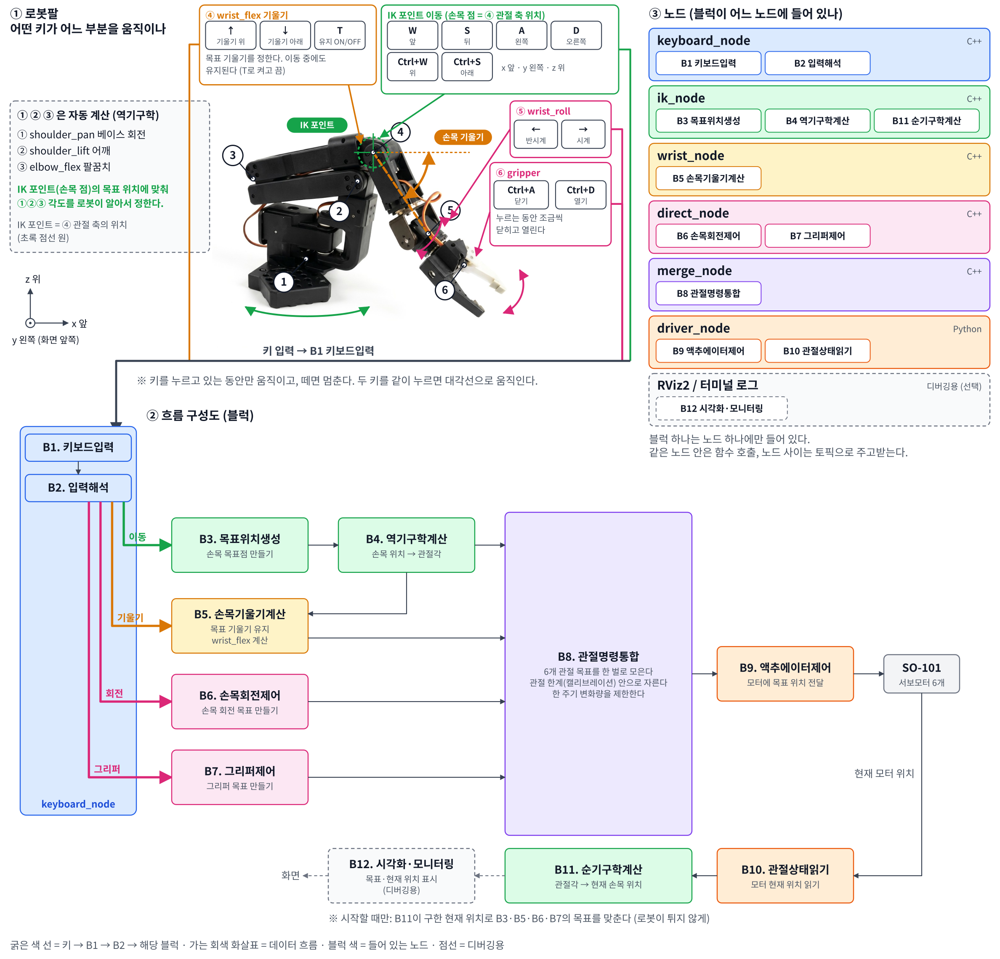

# SO-101 키보드 손목 위치 제어 로봇팔 (ROS 2)

> 기말프로젝트 — **주제선정** (이 문서) · [개념설계(블럭도)](docs/concept-design.md)

---

## 1. 작품명

**키보드로 손목 위치(x, y, z)를 정하고 손목 기울기를 유지하며 움직이는 SO-101 로봇팔**
— 역기구학(IK) 기반 ROS 2(C++) 텔레오퍼레이션

---

## 2. 작품설명

LeRobot SO-101 로봇팔을 키보드로 조종한다.
키로 **손목(아래에서 4번째 관절, wrist_flex 축)이 갈 위치**를 정하면 로봇이 관절 각도를 역기구학으로 계산해서 움직인다.
물체를 잡을 **손목 기울기**는 ↑↓ 키로 정하고, 이 기울기는 손목이 이동하는 동안에도 유지된다. (켜고 끄는 옵션)

### 관절별 조종 방법

| 관절 | 조종 방법 |
|---|---|
| shoulder_pan, shoulder_lift, elbow_flex | **IK가 계산** — 손목 목표 위치로 3개 각도를 구한다 |
| wrist_flex (손목 위아래) | **↑ ↓** 로 목표 기울기를 바꾸면 `목표 기울기 − (어깨 + 팔꿈치)`로 계산 |
| wrist_roll (손목 회전) | **← →** |
| gripper | **Ctrl+A** 닫기 / **Ctrl+D** 열기 |

### 조작키

| 키 | 동작 |
|---|---|
| `W` / `S` | 손목 앞 / 뒤 (x) |
| `A` / `D` | 손목 왼쪽 / 오른쪽 (y) |
| `Ctrl + W` / `Ctrl + S` | 손목 위 / 아래 (z) |
| `↑` / `↓` | 목표 기울기 위 / 아래 |
| `←` / `→` | 손목 회전 |
| `Ctrl + A` / `Ctrl + D` | 그리퍼 닫기 / 열기 |
| `T` | 기울기 유지 켜기 / 끄기 (기본: 켜짐) |

- 키를 누르고 있는 동안만 움직이고, 떼면 그 자세로 멈춘다. 두 키를 같이 누르면 대각선으로 움직인다.
- 관절 한계를 넘는 목표는 무시한다. 기울기를 못 만드는 위치에서는 위치 이동이 우선이고 손목은 한계값에 멈춘다.

### 동작 흐름

`키 입력 → 명령 해석 → 손목 목표 위치 → 역기구학(관절각) → 손목 기울기 계산 → 한계·변화량 제한 → 모터 구동`

### ROS 2 구성

노드 6개를 토픽으로 연결한다. 드라이버만 파이썬이고 나머지는 C++(rclcpp)이다. 실행은 launch 파일과 파라미터 파일(`controller_params.yaml`)로 한다.

| 노드 | 하는 일 |
|---|---|
| `keyboard_node` | 키 상태 읽기, 명령으로 해석 |
| `ik_node` | 목표 손목 위치 만들기, 역기구학, 순기구학 |
| `wrist_node` | 목표 기울기 유지, wrist_flex 계산 |
| `direct_node` | 손목 회전·그리퍼 목표 만들기 |
| `merge_node` | 6개 관절 취합, 관절 한계·변화량 제한 |
| `driver_node` | LeRobot으로 모터에 보내고 현재 위치 읽기 |

실행 환경: WSL2 Ubuntu + ROS 2, 로봇은 USB(usbipd)로 연결, 키 입력은 GLFW 창.

---

## 3. 선정이유

- 사람은 관절 각도가 아니라 "앞으로, 위로"처럼 **위치로 생각**한다. 위치만 정하면 각도는 로봇이 계산하게 해 직관적인 조작이 가능하다.
- 위치는 IK가, **손목 기울기는 사람이 따로** 정해서 물체를 원하는 각도로 잡을 수 있다.
- 리더암 없이 **키보드만으로** 조종할 수 있다.

---

## 4. 필요기술

| 분야 | 필요한 기술 |
|---|---|
| ROS 2 (C++) | 노드, 토픽, 파라미터, launch, rclcpp, colcon |
| 로봇 기구학 | 순기구학(FK), 역기구학(IK), 코사인 법칙, 좌표계(x 앞 / y 왼쪽 / z 위) |
| 로봇 하드웨어 | LeRobot SO-101 파이썬 API, STS3215 서보, 캘리브레이션(관절 한계) |
| 키보드 입력 | GLFW 창으로 키 상태 읽기 (누름/뗌, 동시 입력, Ctrl 조합) |
| 제어 | 작업영역·관절 한계 제한, 변화량 제한, 시작할 때 현재 위치로 목표 맞추기 |
| 개발 환경 | WSL2 Ubuntu, usbipd-win, Git/GitHub |

---

## 정리

- **작품**: 키보드로 SO-101 손목 위치(x, y, z)를 움직이면 로봇이 역기구학으로 관절각을 계산해서 따라가는 ROS 2 텔레오퍼레이션
- **조작**: `WASD`(앞뒤·좌우), `Ctrl+W/S`(위아래), `↑↓`(목표 기울기), `←→`(손목 회전), `Ctrl+A/D`(그리퍼), `T`(기울기 유지 켜기/끄기)
- **구조**: 노드 6개(키 입력, 역기구학, 손목 유지, 직접 제어, 취합, 드라이버), 드라이버만 파이썬
