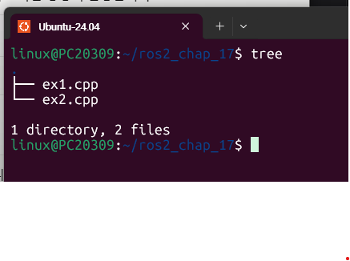
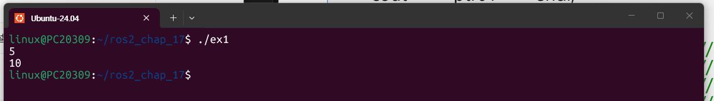
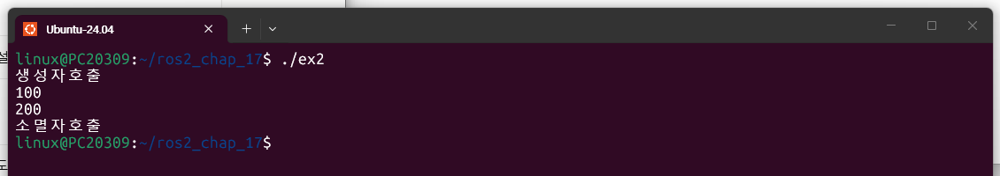

# 17장. C++ 고급기능 (스마트 포인터) — 실습과제

두 과제 모두 일반 포인터(`new`, `delete`)로 작성된 코드를 스마트 포인터로 바꾸는 문제이다. 원본 코드에서 `ptr1`과 `ptr2`가 **같은 동적객체를 함께 가리키므로**, 하나의 동적객체를 여러 스마트 포인터가 가리킬 수 있는 `shared_ptr`로 변경하였다. `unique_ptr`은 하나의 스마트 포인터만 객체를 독점하고 복사할 수 없어서(소유권은 `move()`로만 이전 가능) 이 코드에는 맞지 않는다.

| 구분 | 원본 (일반 포인터) | 변경 (스마트 포인터) |
|---|---|---|
| 헤더파일 | 없음 | `#include<memory>` |
| 객체 생성 | `new int(5)`, `new CTest(100)` | `make_shared<int>(5)`, `make_shared<CTest>(100)` |
| 포인터 복사 | `int* ptr2 = ptr1;` | `shared_ptr<int> ptr2 = ptr1;` (참조 횟수 1 → 2) |
| 메모리 해제 | `delete`를 직접 호출 | 필요 없음 (참조 횟수가 0이 되면 자동 해제) |

---

## 실습과제 1

**다음 코드를 스마트 포인터를 이용한 코드로 변경하시오.**

(`int` 동적객체를 `ptr1`, `ptr2`가 함께 가리키고, `ptr2`로 값을 바꾸는 코드이다.)

### 소스코드 (ex1.cpp)

```cpp
#include<iostream>                          // cout, endl 사용을 위한 헤더파일
#include<memory>                            // 스마트 포인터(shared_ptr, make_shared)가 정의된 헤더파일
using namespace std;                        // std:: 를 생략하기 위한 네임스페이스 선언
int main()                                  // 프로그램 시작 함수
{
    auto ptr1 = make_shared<int>(5);        // int 동적객체를 5로 초기화하여 만들고 ptr1이 가리킴(참조 횟수 1)
    cout << *ptr1 << endl;                  // 포인터처럼 * 연산자로 값을 읽어 5 출력

    shared_ptr<int> ptr2 = ptr1;            // ptr2도 같은 동적객체를 가리킴(참조 횟수 2)
    *ptr2 = 10;                             // ptr2로 값을 10으로 변경(ptr1이 가리키는 객체와 동일)
    cout << *ptr2 << endl;                  // 변경된 값 10 출력

    // delete ptr1;                         // 스마트 포인터는 delete 필요 없음(main 종료 시 자동 해제)

    return 0;                               // 종료 시 ptr2, ptr1 소멸 -> 참조 횟수 0 -> 메모리 자동 해제
}
```

### 실습 절차

1. 소스파일이 있는 폴더 구성 확인

   ```
   $ tree
   ```

   

   `ros2_chap_17` 폴더에 `ex1.cpp`, `ex2.cpp` 두 소스파일이 있는 화면이다.

2. 컴파일 후 실행

   ```
   $ g++ -std=c++17 ex1.cpp -o ex1
   $ ./ex1
   ```

   

   `5`와 `10`이 차례로 출력된 화면이다.

### 출력 결과 설명

`make_shared<int>(5)`로 만든 객체의 값 `5`가 먼저 출력된다. 이어서 `ptr2`가 같은 객체를 가리키게 하고 `*ptr2 = 10`으로 값을 바꾸면, `ptr1`이 가리키는 객체의 값도 같이 바뀐 것이므로 `10`이 출력된다. 원본 코드의 `delete ptr1;`은 쓰지 않았고, `main` 함수가 끝날 때 `ptr2`, `ptr1`의 수명이 다하여 참조 횟수가 0이 되면 메모리가 자동으로 해제된다.

---

## 실습과제 2

**다음 코드를 스마트 포인터를 이용한 코드로 변경하시오.**

(`CTest` 클래스의 객체를 `ptr1`, `ptr2`가 함께 가리키고, `ptr2`로 멤버 값을 바꾸는 코드이다.)

### 소스코드 (ex2.cpp)

```cpp
#include<iostream>                                              // cout, endl 사용을 위한 헤더파일(원본에는 빠져 있어 추가)
#include<memory>                                                // 스마트 포인터가 정의된 헤더파일
using namespace std;                                            // std:: 생략
class CTest                                                     // 테스트용 클래스
{
    int test;                                                   // private 멤버변수
public:
    CTest(int value) { test = value; cout << "생성자호출" << endl; }  // 생성자: 값 저장 후 메시지 출력
    ~CTest() { cout << "소멸자호출" << endl; }                  // 소멸자: 객체가 해제될 때 자동 호출
    int GetTest() { return test; }                              // test 값을 반환하는 getter
    void SetTest(int value) { test = value; }                   // test 값을 변경하는 setter
};

int main()                                                      // 프로그램 시작 함수
{
    auto ptr1 = make_shared<CTest>(100);                        // CTest 객체를 생성자 인자 100으로 만들고 ptr1이 가리킴(생성자호출 출력)
    cout << ptr1->GetTest() << endl;                            // -> 연산자로 멤버함수 호출, 100 출력

    shared_ptr<CTest> ptr2 = ptr1;                              // ptr2도 같은 객체를 가리킴(참조 횟수 2)
    ptr2->SetTest(200);                                         // ptr2로 값을 200으로 변경
    cout << ptr2->GetTest() << endl;                            // 변경된 값 200 출력

    // delete ptr2;                                             // delete 필요 없음

    return 0;                                                   // 종료 시 참조 횟수 0 -> 객체 자동 해제(소멸자호출 출력)
}
```

원본 코드에는 `cout`을 쓰면서도 `#include<iostream>`이 빠져 있어 그대로는 컴파일되지 않는다. 그래서 헤더파일을 추가하였다.

### 실습 절차

1. 컴파일 후 실행

   ```
   $ g++ -std=c++17 ex2.cpp -o ex2
   $ ./ex2
   ```

   

   `생성자호출`, `100`, `200`, `소멸자호출`이 차례로 출력된 화면이다.

### 출력 결과 설명

`make_shared<CTest>(100)`으로 객체를 만드는 순간 생성자가 호출되어 `생성자호출`이 출력되고, `ptr1->GetTest()`로 `100`을 읽는다. `ptr2`가 같은 객체를 가리키게 한 뒤 `ptr2->SetTest(200)`으로 값을 바꾸면 `ptr2->GetTest()`는 `200`을 돌려준다. 마지막에 `소멸자호출`이 출력되는 것은 `main` 함수가 끝나면서 참조 횟수가 0이 되어 객체가 자동으로 해제되었다는 뜻이다. 일반 포인터 코드에서는 `delete ptr2;`를 직접 호출해야 소멸자가 불렸지만, 스마트 포인터는 `delete` 없이도 소멸자가 한 번 호출된다.
