# 18장. rclcpp — 실습과제

강의노트의 패키지 이름 `pub1-1`, `pub1-2`, `pub1-3`은 하이픈 대신 밑줄을 사용하여 `pub1_1`, `pub1_2`, `pub1_3`으로 작성했다. 워크스페이스는 `~/ros2_ws_ch18`이고, 세 패키지 모두 예제 1(`pub1`)의 Publisher 코드를 수정하여 만들었다.

| 과제 | 패키지 | 토픽 이름 | 메시지 인터페이스 | 소스 |
|---|---|---|---|---|
| 1 | `pub1_1` | `/topic_pub1_1` | `std_msgs/msg/Int32` | [pub1_1.cpp](./pub1_1/src/pub1_1.cpp) |
| 2 | `pub1_2` | `/topic_pub1_2` | `geometry_msgs/msg/Vector3` | [pub1_2.cpp](./pub1_2/src/pub1_2.cpp) |
| 3 | `pub1_3` | `/turtle1/cmd_vel` | `geometry_msgs/msg/Twist` | [pub1_3.cpp](./pub1_3/src/pub1_3.cpp) |

---

## 실습과제 1

**예제 1번을 수정하여 문자열 대신에 정수값을 0으로 초기화하고 1씩 증가시키면서 퍼블리시하는 패키지 pub1-1를 작성하시오. 토픽 메시지 인터페이스는 std_msgs/msg/Int32을 사용할 것.**

### 실습 절차

1. 패키지 생성. 의존 패키지는 예제 1과 같이 `rclcpp`, `std_msgs`이다.

   ```
   $ cd ~/ros2_ws_ch18/src
   $ ros2 pkg create pub1_1 --build-type ament_cmake --dependencies rclcpp std_msgs
   $ tree pub1_1
   ```

   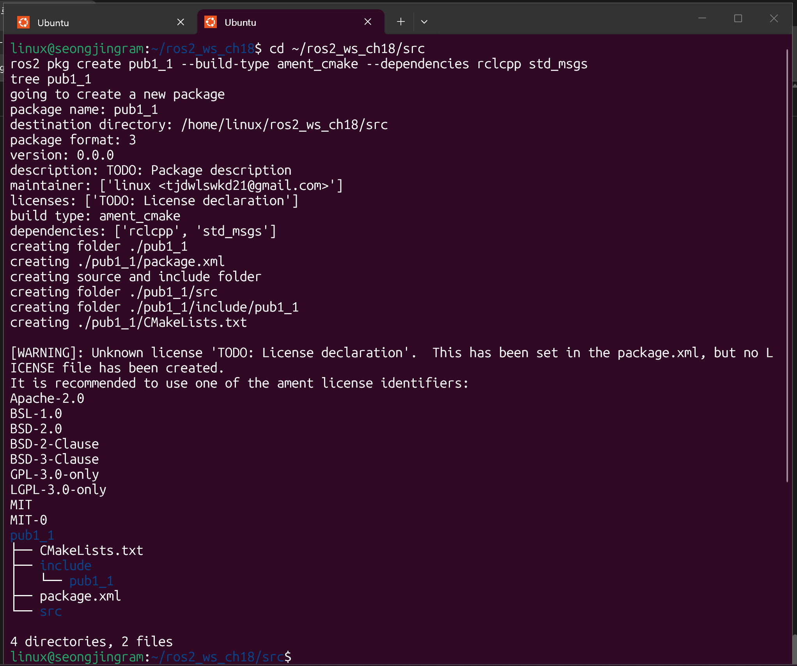

   `pub1_1` 패키지가 만들어졌고, `package.xml`, `CMakeLists.txt`, `include/pub1_1`, `src`가 생성된 것을 `tree`로 확인할 수 있다. 라이선스 경고는 `package.xml`의 license 항목이 `TODO`로 채워졌다는 안내이며 빌드와 실행에는 영향이 없다.

2. `src/pub1_1.cpp`와 `CMakeLists.txt`를 아래 코드로 작성한다.

3. 빌드 후 로컬 설정파일을 적용하고 노드를 실행한다.

   ```
   $ cd ~/ros2_ws_ch18
   $ colcon build --symlink-install --packages-select pub1_1
   $ source install/local_setup.bash
   $ ros2 run pub1_1 pub1_1
   ```

   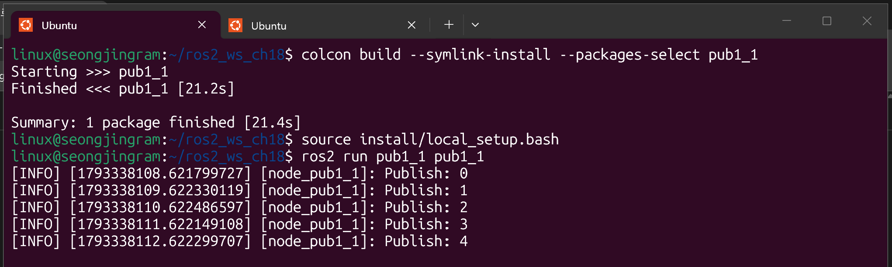

   빌드가 성공했고, 노드 `node_pub1_1`이 `Publish: 0`, `1`, `2`, `3`, `4`를 1초 간격으로 출력한다. 로그의 타임스탬프가 1초씩 늘어나는 것으로도 주기를 확인할 수 있다.

4. 노드를 실행한 상태에서 새 터미널을 열어 `rqt_graph`를 실행한다.

   ```
   $ rqt_graph
   ```

   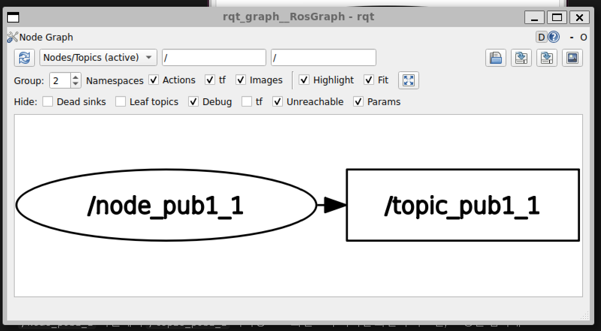

   `/node_pub1_1` 노드에서 `/topic_pub1_1` 토픽으로 화살표가 이어져 있다. 이 노드는 퍼블리셔만 있고 구독하는 노드가 없으므로 토픽에서 나가는 화살표는 없다. 구독자가 없는 토픽이 보이도록 `Dead sinks`와 `Leaf topics` 숨김을 해제했다.

5. 패키지, 노드, 토픽 목록과 토픽 내용을 확인한다.

   ```
   $ ros2 pkg list | grep pub1_1
   $ ros2 node list
   $ ros2 topic list -t
   $ ros2 topic echo /topic_pub1_1
   ```

   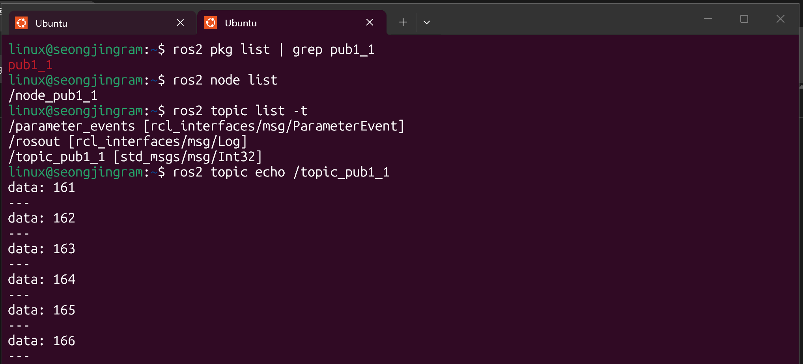

6. 토픽의 주기와 데이터량을 확인한다.

   ```
   $ ros2 topic hz /topic_pub1_1
   $ ros2 topic bw /topic_pub1_1
   ```

   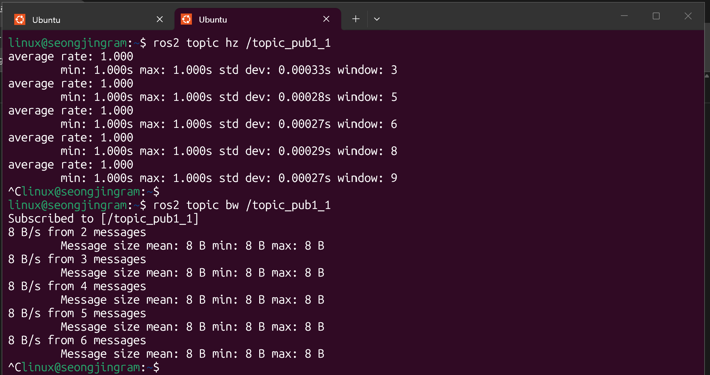

### 소스 코드

**pub1_1/src/pub1_1.cpp**

```cpp
#include "rclcpp/rclcpp.hpp"
#include "std_msgs/msg/int32.hpp"
#include <memory>
#include <chrono>
int main(int argc, char * argv[])
{
    rclcpp::init(argc, argv);
    auto node = std::make_shared<rclcpp::Node>("node_pub1_1");
    auto qos_profile = rclcpp::QoS(rclcpp::KeepLast(10));
    auto mypub = node->create_publisher<std_msgs::msg::Int32>("topic_pub1_1",
    qos_profile );
    std_msgs::msg::Int32 message;
    message.data = 0;
    rclcpp::WallRate loop_rate(1.0); //반복주파수를 저장하는 객체(단위 Hz)
    while(rclcpp::ok())
    {
        RCLCPP_INFO(node->get_logger(), "Publish: %d", message.data);
        mypub->publish(message);
        message.data++;
        loop_rate.sleep(); //반복주기에서 남은 시간 만큼 sleep
    }
    rclcpp::shutdown();
    return 0;
}
```

**pub1_1/CMakeLists.txt**

```cmake
cmake_minimum_required(VERSION 3.16)
project(pub1_1)

# Default to C++14
if(NOT CMAKE_CXX_STANDARD)
    set(CMAKE_CXX_STANDARD 14)
endif()

if(CMAKE_COMPILER_IS_GNUCXX OR CMAKE_CXX_COMPILER_ID MATCHES "Clang")
    add_compile_options(-Wall -Wextra -Wpedantic)
endif()

# find dependencies
find_package(ament_cmake REQUIRED)
find_package(rclcpp REQUIRED)
find_package(std_msgs REQUIRED)

#build
add_executable(pub1_1 src/pub1_1.cpp)
ament_target_dependencies(pub1_1 rclcpp std_msgs)

# Install
install(TARGETS
    pub1_1
    DESTINATION lib/${PROJECT_NAME})

ament_package()
```

### 코드 설명

- 1~4행: `rclcpp/rclcpp.hpp`는 ROS2 소스에 항상 포함해야 한다. 메시지 인터페이스 헤더는 별도로 포함해야 하므로 `std_msgs/msg/Int32`를 쓰기 위해 `std_msgs/msg/int32.hpp`를 포함했다. 예제 1의 `string.hpp`를 `int32.hpp`로 바꾼 부분이다. `<memory>`는 `std::make_shared`, `<chrono>`는 예제 1과 같이 시간 관련 기능을 위해 포함했다.
- 7행: `rclcpp::init(argc, argv)`는 ROS2 초기화 작업을 수행하며 main 함수에서 가장 먼저 호출한다.
- 8행: `std::make_shared<rclcpp::Node>("node_pub1_1")`로 노드 객체를 동적 생성하고 스마트 포인터로 관리한다. 노드 이름 `node_pub1_1`은 `ros2 node list`로 검색된다.
- 9행: `rclcpp::QoS(rclcpp::KeepLast(10))`은 History 옵션을 KEEP_LAST, depth=10으로 설정하고 나머지는 기본값으로 둔 QoS 객체를 만든다.
- 10~11행: `create_publisher<std_msgs::msg::Int32>("topic_pub1_1", qos_profile)`로 `Publisher<Int32>` 객체를 동적 생성하고 그 주소를 담은 `shared_ptr`을 `mypub`에 저장한다. 토픽 이름 `topic_pub1_1`은 `ros2 topic list -t`로 확인된다. 예제 1의 `String`을 `Int32`로 바꾼 부분이다.
- 12~13행: 전송할 `Int32` 메시지 객체를 만들고 `data`를 0으로 초기화한다. `Int32`는 `data` 필드 하나만 가진다.
- 14행: `rclcpp::WallRate loop_rate(1.0)`은 반복 주파수 1Hz(1초 주기)를 저장하는 객체이다.
- 15행: `rclcpp::ok()`는 Ctrl+C와 같은 종료 조건이 발생하면 false를 반환하므로 그때까지 반복한다.
- 17행: `RCLCPP_INFO`로 현재 값을 터미널에 출력한다. 정수이므로 `%d`를 사용했다.
- 18행: `mypub->publish(message)`로 메시지를 퍼블리시한다.
- 19행: 퍼블리시한 뒤 `message.data++`로 값을 1 증가시킨다. 따라서 0부터 시작해 1씩 커진다.
- 20행: `loop_rate.sleep()`은 반복 주기 중 남은 시간만큼 쉰다.
- 22~23행: 반복이 끝나면 `rclcpp::shutdown()`으로 ROS2를 종료하고 main 함수를 마친다.
- CMakeLists.txt: `find_package(std_msgs REQUIRED)`로 의존 패키지를 찾고, `add_executable(pub1_1 src/pub1_1.cpp)`로 실행 파일을 만들며, `ament_target_dependencies`로 `rclcpp`, `std_msgs`의 include 디렉터리와 라이브러리를 연결한다. `install(TARGETS ...)`로 `lib/pub1_1` 아래에 설치하고, `ament_package()`는 파일 마지막에 둔다.

### 출력 결과 설명

`ros2 pkg list`에는 `pub1_1`이, `ros2 node list`에는 `/node_pub1_1`이 나온다. `ros2 topic list -t`에는 `/topic_pub1_1 [std_msgs/msg/Int32]`가 나오며, 나머지 `/parameter_events [rcl_interfaces/msg/ParameterEvent]`와 `/rosout [rcl_interfaces/msg/Log]`는 노드를 실행하면 기본으로 생기는 토픽이다.

`ros2 topic echo`는 `data: 161`, `162`, `163`…처럼 값이 1씩 커지며 `---` 구분선과 함께 출력된다. 값이 161부터 보이는 것은 노드를 켠 뒤 시간이 지난 시점에 echo를 실행했기 때문이다.

`ros2 topic hz`에서 `average rate: 1.000`이 나오고 최소·최대 간격이 약 1.000초로 `WallRate(1.0)`이 의도한 대로 동작한다. `ros2 topic bw`에서는 `Message size mean: 8 B`로, 메시지 하나가 8바이트로 측정되었고 초당 약 8 B/s 전송된다. 이 8바이트는 `Int32` 값 4바이트에 직렬화에 쓰이는 헤더가 더해진 크기로 보이며, 필드 크기를 바탕으로 한 해석이다.

---

## 실습과제 2

**예제 1번을 수정하여 키보드로부터 실수값 3개를 입력 받아 퍼블리시하는 패키지 pub1-2를 작성하시오. 토픽 메시지 인터페이스는 geometry_msgs/msg/Vector3을 사용.**

### 실습 절차

1. 패키지 생성. 의존 패키지를 `std_msgs`에서 `geometry_msgs`로 바꾼다.

   ```
   $ cd ~/ros2_ws_ch18/src
   $ ros2 pkg create pub1_2 --build-type ament_cmake --dependencies rclcpp geometry_msgs
   $ tree pub1_2
   ```

   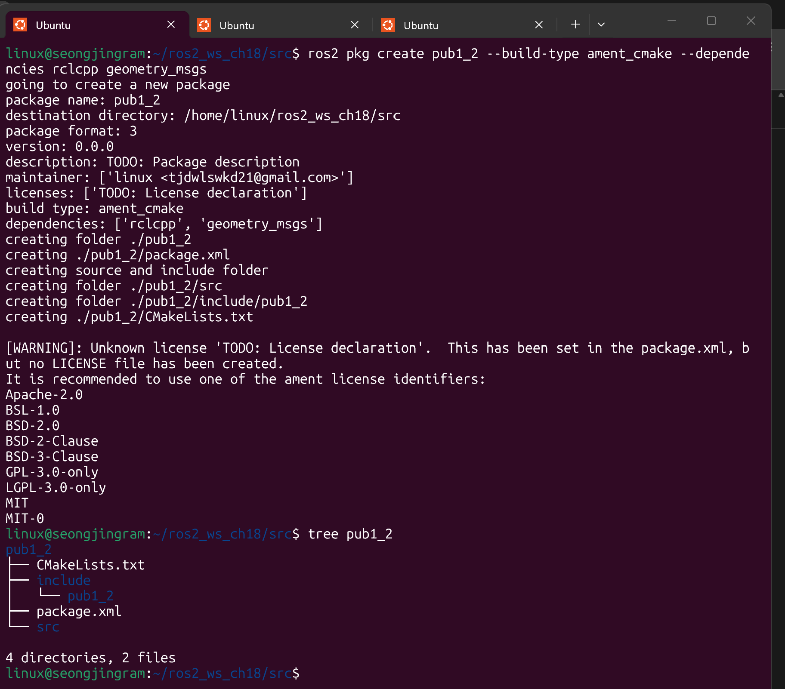

   의존 패키지가 `rclcpp`, `geometry_msgs`로 표시되며 `pub1_2` 패키지가 만들어졌다. `tree`로 `package.xml`, `CMakeLists.txt`, `include/pub1_2`, `src`가 생성된 것을 확인할 수 있다.

2. `src/pub1_2.cpp`와 `CMakeLists.txt`를 아래 코드로 작성한다.

3. 빌드 후 실행하고 실수 3개를 입력한다.

   ```
   $ cd ~/ros2_ws_ch18
   $ colcon build --symlink-install --packages-select pub1_2
   $ source install/local_setup.bash
   $ ros2 run pub1_2 pub1_2
   ```

   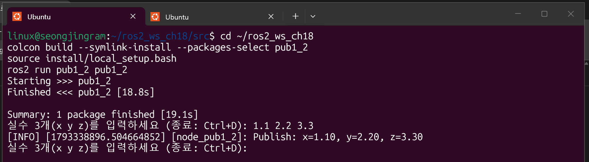

   빌드가 성공했고, 안내 문구 뒤에 `1.1 2.2 3.3`을 입력하자 `Publish: x=1.10, y=2.20, z=3.30`이 출력되었다. 출력 후에는 다시 입력을 기다린다.

4. 노드를 실행한 상태에서 `rqt_graph`를 실행한다.

   ```
   $ rqt_graph
   ```

   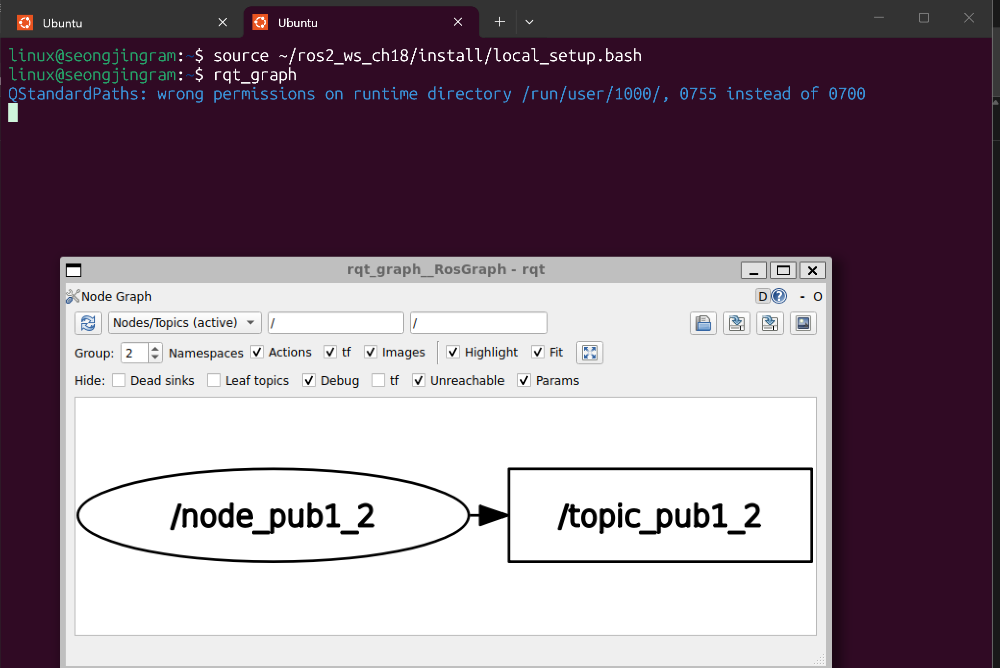

   `/node_pub1_2` 노드에서 `/topic_pub1_2` 토픽으로 화살표가 이어져 있다.

5. 노드와 토픽 목록, 토픽 내용을 확인한다. 이 노드는 입력할 때만 퍼블리시하므로 echo를 먼저 켜 둔 뒤 다른 터미널에서 `1.5 2.5 3.5`를 입력했다.

   ```
   $ ros2 node list
   $ ros2 topic list -t
   $ ros2 topic echo /topic_pub1_2
   ```

   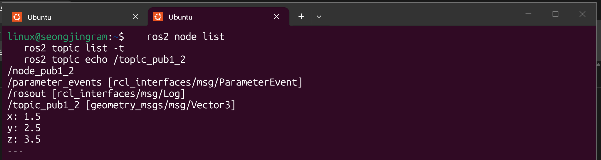

### 소스 코드

**pub1_2/src/pub1_2.cpp**

```cpp
#include "rclcpp/rclcpp.hpp"
#include "geometry_msgs/msg/vector3.hpp"
#include <memory>
#include <iostream>
int main(int argc, char * argv[])
{
    rclcpp::init(argc, argv);
    auto node = std::make_shared<rclcpp::Node>("node_pub1_2");
    auto qos_profile = rclcpp::QoS(rclcpp::KeepLast(10));
    auto mypub = node->create_publisher<geometry_msgs::msg::Vector3>("topic_pub1_2",
    qos_profile );
    geometry_msgs::msg::Vector3 message;
    while(rclcpp::ok())
    {
        std::cout << "실수 3개(x y z)를 입력하세요 (종료: Ctrl+D): ";
        if(!(std::cin >> message.x >> message.y >> message.z))
            break;
        RCLCPP_INFO(node->get_logger(), "Publish: x=%.2f, y=%.2f, z=%.2f",
                    message.x, message.y, message.z);
        mypub->publish(message);
    }
    rclcpp::shutdown();
    return 0;
}
```

**pub1_2/CMakeLists.txt**

```cmake
cmake_minimum_required(VERSION 3.16)
project(pub1_2)

# Default to C++14
if(NOT CMAKE_CXX_STANDARD)
    set(CMAKE_CXX_STANDARD 14)
endif()

if(CMAKE_COMPILER_IS_GNUCXX OR CMAKE_CXX_COMPILER_ID MATCHES "Clang")
    add_compile_options(-Wall -Wextra -Wpedantic)
endif()

# find dependencies
find_package(ament_cmake REQUIRED)
find_package(rclcpp REQUIRED)
find_package(geometry_msgs REQUIRED)

#build
add_executable(pub1_2 src/pub1_2.cpp)
ament_target_dependencies(pub1_2 rclcpp geometry_msgs)

# Install
install(TARGETS
    pub1_2
    DESTINATION lib/${PROJECT_NAME})

ament_package()
```

### 코드 설명

- 1~4행: 메시지 인터페이스 헤더를 `geometry_msgs/msg/vector3.hpp`로 바꿨다. 키보드 입력을 위해 `<iostream>`을 추가했다.
- 7~9행: 초기화, 노드 생성(`node_pub1_2`), QoS 설정은 예제 1과 같다.
- 10~11행: `create_publisher<geometry_msgs::msg::Vector3>("topic_pub1_2", qos_profile)`로 `Vector3`를 퍼블리시하는 객체를 만든다.
- 12행: `Vector3`는 실수 필드 `x`, `y`, `z` 세 개로 이루어진 메시지이다.
- 13행: `rclcpp::ok()`가 true인 동안 반복한다. 이 노드는 키보드 입력을 기다리며 반복하므로 `WallRate`는 사용하지 않았다.
- 15행: 입력할 값의 형식을 안내하는 문구를 출력한다.
- 16~17행: `std::cin >> message.x >> message.y >> message.z`로 공백으로 구분된 실수 3개를 한 번에 입력받아 메시지 필드에 저장한다. 입력이 실패하거나 Ctrl+D(EOF)가 입력되면 조건식이 false가 되어 `break`로 반복을 빠져나간다.
- 18~19행: 입력받은 값을 소수 둘째 자리까지 `%.2f`로 출력한다.
- 20행: 입력받은 메시지를 퍼블리시한다. 입력할 때마다 한 번씩 퍼블리시된다.
- 22~23행: 반복이 끝나면 `rclcpp::shutdown()`으로 종료한다.
- CMakeLists.txt: 의존 패키지가 `std_msgs`에서 `geometry_msgs`로 바뀌어 `find_package(geometry_msgs REQUIRED)`와 `ament_target_dependencies(pub1_2 rclcpp geometry_msgs)`를 사용한다.

### 출력 결과 설명

`ros2 node list`에는 `/node_pub1_2`가 나오고, `ros2 topic list -t`에는 `/topic_pub1_2 [geometry_msgs/msg/Vector3]`가 나온다. `/parameter_events`와 `/rosout`은 기본 토픽이다.

`ros2 topic echo /topic_pub1_2`는 입력이 있을 때만 출력된다. 다른 터미널에서 `1.5 2.5 3.5`를 입력하자 `x: 1.5`, `y: 2.5`, `z: 3.5`가 `---` 구분선과 함께 출력되어, 키보드로 입력한 실수 3개가 `Vector3` 메시지로 전달됨을 확인했다. 예제 1의 `Int32`와 달리 입력 시에만 발행되므로 `hz`와 `bw`로 주기를 보는 것은 의미가 없어 확인하지 않았다.

---

## 실습과제 3

**Turtlesim 패키지의 teleop_turtle 노드를 대신하는 패키지 pub1-3를 작성하라. 키보드 입력시 /turtle1/cmd_vel 토픽을 발행하도록 할 것. f는 전진, b는 후진, l은 좌회전, r은 우회전. 메시지 인터페이스는 geometry_msgs/msg/Twist를 사용할 것.**

### 실습 절차

1. 패키지 생성. 의존 패키지는 `rclcpp`, `geometry_msgs`이다.

   ```
   $ cd ~/ros2_ws_ch18/src
   $ ros2 pkg create pub1_3 --build-type ament_cmake --dependencies rclcpp geometry_msgs
   $ tree
   ```

   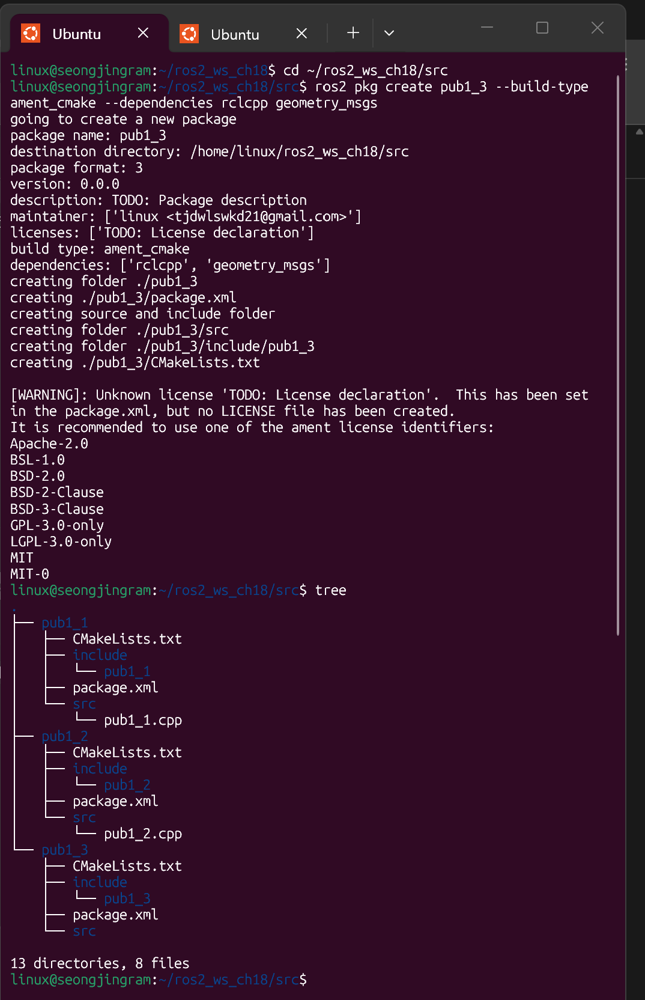

   `pub1_3` 패키지가 만들어졌다. `tree`를 `src` 전체에서 실행하여 앞서 만든 `pub1_1`, `pub1_2`와 함께 구조가 보인다.

2. `src/pub1_3.cpp`와 `CMakeLists.txt`를 아래 코드로 작성한다.

3. 빌드한다.

   ```
   $ cd ~/ros2_ws_ch18
   $ colcon build --symlink-install --packages-select pub1_3
   ```

   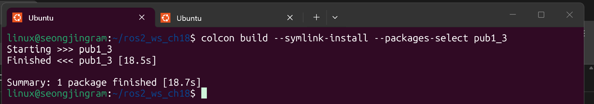

   `Finished <<< pub1_3`가 출력되며 빌드가 성공했다.

4. 터미널 1에서 subscriber 역할을 하는 turtlesim 노드를 실행한다.

   ```
   $ ros2 run turtlesim turtlesim_node
   ```

   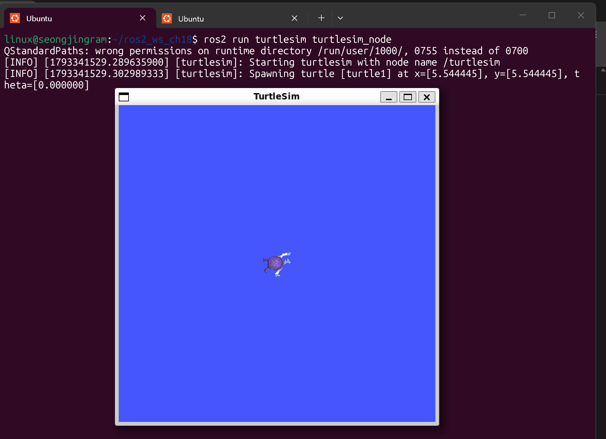

   `Starting turtlesim with node name /turtlesim`와 함께 `Spawning turtle [turtle1] at x=[5.544445], y=[5.544445], theta=[0.000000]` 로그가 출력되고, 파란 배경에 거북이가 창 가운데에 나타났다.

5. 터미널 2에서 `pub1_3`를 실행하고 키보드로 거북이를 조종한다. 터미널을 클릭해 포커스를 준 상태에서 키를 누른다.

   ```
   $ source ~/ros2_ws_ch18/install/local_setup.bash
   $ ros2 run pub1_3 pub1_3
   ```

   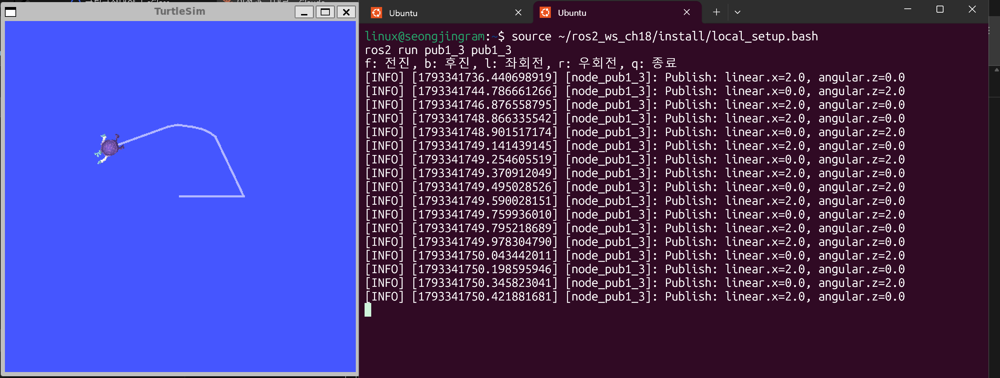

   키를 누를 때마다 `Publish: linear.x=2.0, angular.z=0.0`(전진) 또는 `Publish: linear.x=0.0, angular.z=2.0`(회전)이 출력되고, 거북이가 움직인 궤적이 파란 화면에 선으로 남아 꺾이며 이동한 것을 볼 수 있다.

6. 노드가 실행된 상태에서 `rqt_graph`를 실행한다.

   ```
   $ rqt_graph
   ```

   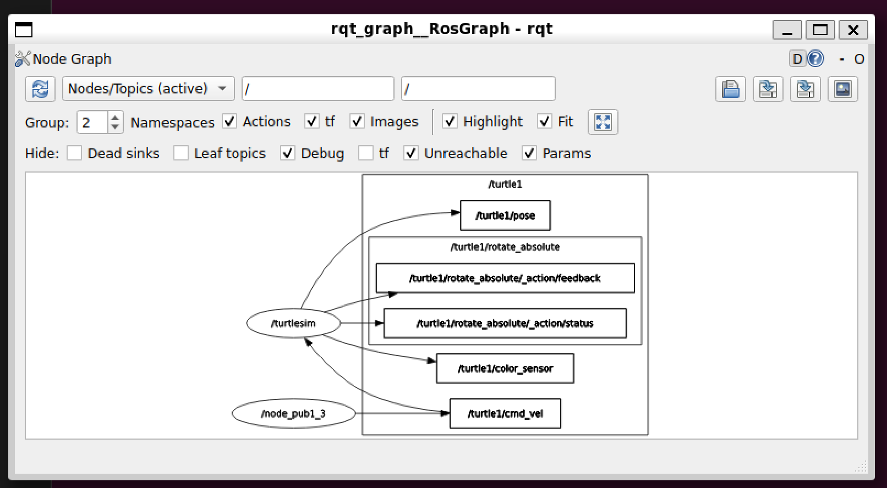

   `/node_pub1_3`이 `/turtle1/cmd_vel`로 퍼블리시하고, `/turtlesim`이 이 토픽을 구독한다. `/turtlesim`이 발행하는 `/turtle1/pose`, `/turtle1/color_sensor`와 액션 관련 토픽도 함께 보인다.

7. 토픽 목록과 `/turtle1/cmd_vel` 내용을 확인한다. echo를 먼저 켜 둔 뒤 `pub1_3` 터미널에서 키를 눌렀다.

   ```
   $ ros2 topic list -t
   $ ros2 topic echo /turtle1/cmd_vel
   ```

   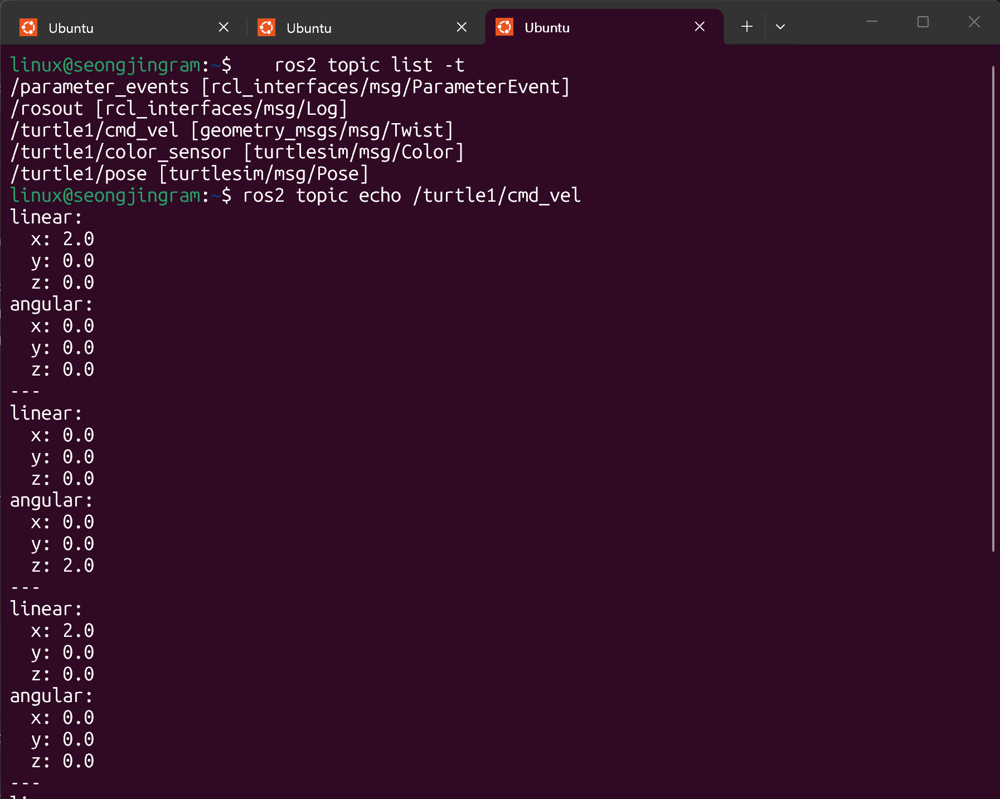

### 소스 코드

**pub1_3/src/pub1_3.cpp**

```cpp
#include "rclcpp/rclcpp.hpp"
#include "geometry_msgs/msg/twist.hpp"
#include <memory>
#include <iostream>
#include <termios.h>
#include <unistd.h>
int main(int argc, char * argv[])
{
    rclcpp::init(argc, argv);
    auto node = std::make_shared<rclcpp::Node>("node_pub1_3");
    auto qos_profile = rclcpp::QoS(rclcpp::KeepLast(10));
    auto mypub = node->create_publisher<geometry_msgs::msg::Twist>("/turtle1/cmd_vel",
    qos_profile );

    // 엔터 없이 키 하나를 바로 읽도록 터미널 설정 변경
    termios oldt, newt;
    tcgetattr(STDIN_FILENO, &oldt);
    newt = oldt;
    newt.c_lflag &= ~(ICANON | ECHO);
    newt.c_cc[VMIN] = 0;
    newt.c_cc[VTIME] = 1;
    tcsetattr(STDIN_FILENO, TCSANOW, &newt);

    std::cout << "f: 전진, b: 후진, l: 좌회전, r: 우회전, q: 종료" << std::endl;
    while(rclcpp::ok())
    {
        char key = 0;
        if(read(STDIN_FILENO, &key, 1) <= 0)
            continue;
        geometry_msgs::msg::Twist message;
        if(key == 'f')      message.linear.x  =  2.0;
        else if(key == 'b') message.linear.x  = -2.0;
        else if(key == 'l') message.angular.z =  2.0;
        else if(key == 'r') message.angular.z = -2.0;
        else if(key == 'q') break;
        else continue;
        RCLCPP_INFO(node->get_logger(), "Publish: linear.x=%.1f, angular.z=%.1f",
                    message.linear.x, message.angular.z);
        mypub->publish(message);
    }
    tcsetattr(STDIN_FILENO, TCSANOW, &oldt);
    rclcpp::shutdown();
    return 0;
}
```

**pub1_3/CMakeLists.txt**

```cmake
cmake_minimum_required(VERSION 3.16)
project(pub1_3)

# Default to C++14
if(NOT CMAKE_CXX_STANDARD)
    set(CMAKE_CXX_STANDARD 14)
endif()

if(CMAKE_COMPILER_IS_GNUCXX OR CMAKE_CXX_COMPILER_ID MATCHES "Clang")
    add_compile_options(-Wall -Wextra -Wpedantic)
endif()

# find dependencies
find_package(ament_cmake REQUIRED)
find_package(rclcpp REQUIRED)
find_package(geometry_msgs REQUIRED)

#build
add_executable(pub1_3 src/pub1_3.cpp)
ament_target_dependencies(pub1_3 rclcpp geometry_msgs)

# Install
install(TARGETS
    pub1_3
    DESTINATION lib/${PROJECT_NAME})

ament_package()
```

### 코드 설명

- 1~6행: 메시지 인터페이스 헤더는 `geometry_msgs/msg/twist.hpp`이다. 엔터 없이 키를 읽기 위해 터미널 제어용 `<termios.h>`와 `read` 함수용 `<unistd.h>`를 포함했다.
- 9~11행: 초기화, 노드 생성(`node_pub1_3`), QoS 설정은 예제 1과 같다.
- 12~13행: `create_publisher<geometry_msgs::msg::Twist>("/turtle1/cmd_vel", qos_profile)`로 turtlesim이 구독하는 토픽 `/turtle1/cmd_vel`에 `Twist`를 퍼블리시하는 객체를 만든다.
- 16~22행: 터미널 입력 방식을 바꾼다. `tcgetattr`로 현재 설정을 `oldt`에 저장하고, 복사본 `newt`에서 `ICANON`과 `ECHO`를 끈다. `ICANON`을 끄면 엔터를 누르지 않아도 키 하나가 바로 입력되고, `ECHO`를 끄면 누른 키가 화면에 찍히지 않는다. `VMIN=0`, `VTIME=1`은 입력이 없어도 최대 0.1초 뒤에 `read`가 반환되도록 하여, 대기 중에도 반복문이 `rclcpp::ok()`를 계속 확인하게 한다. `tcsetattr`로 새 설정을 적용한다.
- 24행: 사용할 수 있는 키를 안내하는 문구를 출력한다.
- 25~29행: `rclcpp::ok()`가 true인 동안 반복하며, `read`로 키 하나를 읽는다. 입력이 없으면 `continue`로 다시 확인한다.
- 30행: 키가 입력될 때마다 `Twist` 메시지를 새로 만든다. 모든 필드가 0으로 초기화되므로 해당 키의 값만 설정하면 된다. `Twist`는 선속도 `linear`와 각속도 `angular`, 두 개의 `Vector3`로 이루어져 있다.
- 31~36행: `f`는 `linear.x = 2.0`(전진), `b`는 `linear.x = -2.0`(후진), `l`은 `angular.z = 2.0`(좌회전), `r`은 `angular.z = -2.0`(우회전)이다. `q`를 누르면 `break`로 반복을 종료하고, 그 외의 키는 무시한다.
- 37~39행: 설정한 값을 출력하고 퍼블리시한다. 키를 누를 때마다 한 번씩 퍼블리시된다.
- 41행: 종료하기 전에 `tcsetattr`로 저장해 둔 원래 터미널 설정(`oldt`)을 복원한다.
- 42~43행: `rclcpp::shutdown()`으로 종료한다.
- CMakeLists.txt: 과제 2와 같이 `geometry_msgs`를 의존 패키지로 사용한다.

### 출력 결과 설명

`ros2 topic list -t`에는 `/turtle1/cmd_vel [geometry_msgs/msg/Twist]`가 나온다. turtlesim이 만든 `/turtle1/color_sensor [turtlesim/msg/Color]`, `/turtle1/pose [turtlesim/msg/Pose]`도 함께 나온다. turtlesim을 켠 상태에서 `pub1_3`를 실행했으므로 `pub1_3`이 퍼블리시하는 토픽을 turtlesim이 구독한다.

`ros2 topic echo /turtle1/cmd_vel`에서 첫 메시지는 `linear.x: 2.0`이고 나머지는 0으로 `f`에 해당한다. 두 번째 메시지는 `angular.z: 2.0`이고 나머지는 0으로 `l`에 해당하며, 세 번째 메시지는 다시 `linear.x: 2.0`이다. 키 입력이 `Twist` 메시지로 바뀌어 전달되었고, 그 값에 따라 turtlesim의 거북이가 움직였으므로 `turtle_teleop_key`를 대신해 `pub1_3`로 거북이를 조종할 수 있음을 확인했다.
