# 19장. rclcpp 2 (Publisher) — 실습과제

소스파일은 각 패키지 폴더에 있다.

| 과제 | 패키지 | 소스파일 | CMakeLists.txt |
|---|---|---|---|
| 실습과제 1 | `pub2_1` | [pub2_1/src/pub2_1.cpp](./pub2_1/src/pub2_1.cpp) | [pub2_1/CMakeLists.txt](./pub2_1/CMakeLists.txt) |
| 실습과제 2 | `pub2_2` | [pub2_2/src/pub2_2.cpp](./pub2_2/src/pub2_2.cpp) | [pub2_2/CMakeLists.txt](./pub2_2/CMakeLists.txt) |
| 실습과제 3 | `pub2_3` | [pub2_3/src/pub2_3.cpp](./pub2_3/src/pub2_3.cpp) | [pub2_3/CMakeLists.txt](./pub2_3/CMakeLists.txt) |

세 과제 모두 예제 1(`pub2`)의 구조를 그대로 쓴다. 타이머(`create_wall_timer`)가 100ms마다 콜백함수를 호출하고, 콜백함수가 메시지를 만들어 `publish()`한다. 콜백함수에 매개변수(`node`, `pub` 등)가 있으므로 `std::bind`로 `std::function<void()>` 형태로 바꿔서 타이머에 전달한다.

---

## 실습과제 1

**예제 1번을 수정하여 문자열 대신에 정수값을 0으로 초기화하고 1씩 증가시키면서 퍼블리시하는 패키지 pub2-1를 작성하시오. 토픽 메시지 인터페이스는 std_msgs/msg/Int32을 사용할 것. ROS2 명령어로 실행 결과를 확인하라. 토픽메시지의 수신 주기와 주파수를 설명하라.**

ROS 2 패키지 이름에는 하이픈을 쓸 수 없어 패키지 이름은 `pub2_1`로 만들었다.

### 패키지 생성

```
$ cd ~/ros2_ws/src
$ ros2 pkg create pub2_1 --build-type ament_cmake --dependencies rclcpp std_msgs
```

### 소스파일 (`pub2_1/src/pub2_1.cpp`)

```cpp
#include "rclcpp/rclcpp.hpp"
#include "std_msgs/msg/int32.hpp"
#include <memory>
#include <chrono>
#include <functional>
using namespace std::chrono_literals;

void callback(rclcpp::Node::SharedPtr node,
              rclcpp::Publisher<std_msgs::msg::Int32>::SharedPtr mypub)
{
    static int count = 0;
    auto message = std_msgs::msg::Int32();
    message.data = count++;
    RCLCPP_INFO(node->get_logger(), "Publish: %d", message.data);
    mypub->publish(message);
}

int main(int argc, char* argv[])
{
    rclcpp::init(argc, argv);
    auto node = std::make_shared<rclcpp::Node>("mynode");
    auto qos_profile = rclcpp::QoS(rclcpp::KeepLast(10));
    auto pub = node->create_publisher<std_msgs::msg::Int32>("mytopic", qos_profile);
    std::function<void()> fn = std::bind(callback, node, pub);
    auto timer = node->create_wall_timer(100ms, fn);
    rclcpp::spin(node);
    rclcpp::shutdown();
    return 0;
}
```

### 줄 단위 코드 설명

| 줄 | 코드 | 설명 |
|---|---|---|
| 1 | `#include "rclcpp/rclcpp.hpp"` | ROS 2 C++ 클라이언트 라이브러리(노드, 퍼블리셔, 타이머 등)를 사용하기 위한 헤더 |
| 2 | `#include "std_msgs/msg/int32.hpp"` | 메시지 인터페이스 `std_msgs/msg/Int32`의 헤더. 예제 1의 `string.hpp`에서 바꾼 부분 |
| 3~5 | `#include <memory>` 등 | `std::make_shared`, `std::chrono`, `std::bind`/`std::function`에 필요한 표준 헤더 |
| 6 | `using namespace std::chrono_literals;` | `100ms`처럼 숫자와 단위를 붙인 사용자 정의 리터럴을 쓰기 위한 선언 |
| 8~9 | `void callback(node, mypub)` | 타이머 이벤트가 발생할 때 실행되는 콜백함수. 노드와 퍼블리셔를 매개변수로 받는다 |
| 11 | `static int count = 0;` | 함수가 끝나도 값이 유지되는 정적 변수. 0으로 초기화되어 호출될 때마다 1씩 증가한다 |
| 12 | `auto message = std_msgs::msg::Int32();` | 발행할 메시지 객체 생성. 클래스명을 `String`에서 `Int32`로 바꾼 부분 |
| 13 | `message.data = count++;` | 현재 `count` 값을 `data`에 넣고, 이어서 `count`를 1 증가시킨다. 첫 값은 0이다 |
| 14 | `RCLCPP_INFO(..., "Publish: %d", ...)` | 터미널에 로그를 출력한다. 정수이므로 `%s`가 아니라 `%d`를 쓴다 |
| 15 | `mypub->publish(message);` | 메시지를 `mytopic` 토픽으로 발행 |
| 18 | `int main(int argc, char* argv[])` | 프로그램 시작점 |
| 20 | `rclcpp::init(argc, argv);` | ROS 2 통신을 초기화 |
| 21 | `std::make_shared<rclcpp::Node>("mynode")` | 이름이 `mynode`인 노드를 동적으로 생성하고 `shared_ptr`로 받는다 |
| 22 | `rclcpp::QoS(rclcpp::KeepLast(10))` | QoS 설정. 전송되지 못한 메시지를 최근 10개까지 보관 |
| 23 | `node->create_publisher<std_msgs::msg::Int32>("mytopic", qos_profile)` | `Int32` 메시지를 `mytopic` 토픽으로 발행하는 퍼블리셔 생성 |
| 24 | `std::function<void()> fn = std::bind(callback, node, pub);` | 매개변수 두 개를 미리 묶어서 `void()` 형태의 함수로 변형. `create_wall_timer`는 매개변수 없는 함수만 받기 때문이다 |
| 25 | `node->create_wall_timer(100ms, fn)` | 100ms 주기의 타이머를 만들고 콜백함수 `fn`을 등록 |
| 26 | `rclcpp::spin(node);` | 노드를 계속 실행하며 타이머 이벤트가 발생하면 콜백을 호출한다. `Ctrl+C`가 들어오면 리턴 |
| 27 | `rclcpp::shutdown();` | ROS 2 통신 종료 |
| 28 | `return 0;` | 프로그램 정상 종료 |

### CMakeLists.txt에서 예제 1과 달라진 부분

| 항목 | 예제 1 | pub2_1 |
|---|---|---|
| `project(...)` | `pub2` | `pub2_1` |
| `add_executable(...)` | `pub2 src/pub.cpp` | `pub2_1 src/pub2_1.cpp` |
| 의존 패키지 | `rclcpp`, `std_msgs` | `rclcpp`, `std_msgs` (같음) |

### 실습 절차

1. 워크스페이스에서 빌드하고 환경을 source한 뒤 실행한다. `Publish: 0`부터 1씩 증가하는 로그가 출력된다.

   ```
   $ cd ~/ros2_ws
   $ colcon build --symlink-install --packages-select pub2_1
   $ source install/local_setup.bash
   $ ros2 run pub2_1 pub2_1
   ```

   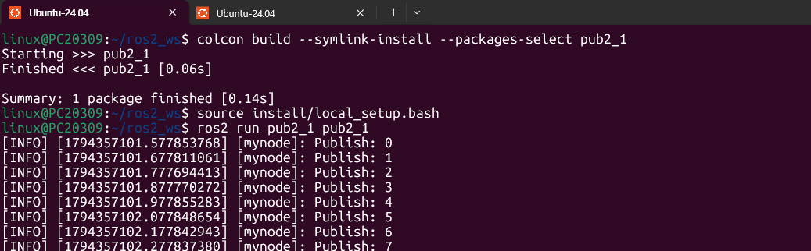

   `Summary: 1 package finished`로 빌드가 성공했고, 실행하면 `Publish: 0`, `1`, `2`, … 로그가 출력된다. 로그의 타임스탬프 간격이 약 0.1초이다.

2. 다른 터미널에서 `rqt_graph`를 실행한다.

   ```
   $ rqt_graph
   ```

   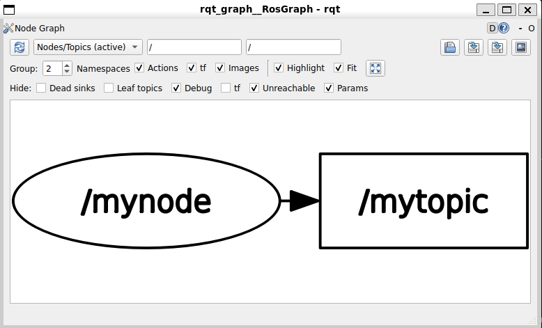

   `/mynode` 노드에서 `/mytopic` 토픽으로 화살표가 이어진다. 노드가 토픽에 발행하고 있다는 뜻이다.

3. 패키지, 노드, 토픽 목록을 확인한다.

   ```
   $ ros2 pkg list | grep pub2_1
   $ ros2 node list
   $ ros2 topic list -t
   ```

   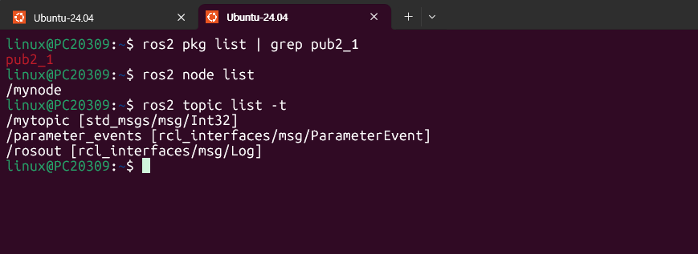

   패키지 `pub2_1`, 노드 `/mynode`, 토픽 `/mytopic [std_msgs/msg/Int32]`가 나온다. 메시지 인터페이스가 `Int32`임을 확인할 수 있다.

4. 토픽의 내용을 출력한다.

   ```
   $ ros2 topic echo /mytopic
   ```

   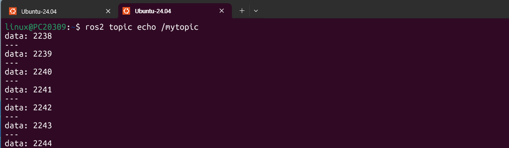

   `data:` 값이 2238, 2239, 2240, …으로 1씩 증가한다. 퍼블리셔를 켠 지 시간이 지난 뒤에 `echo`를 실행해서 값이 0이 아닌 중간 값부터 보인다.

5. 토픽의 주기와 주파수를 확인한다.

   ```
   $ ros2 topic hz /mytopic
   ```

   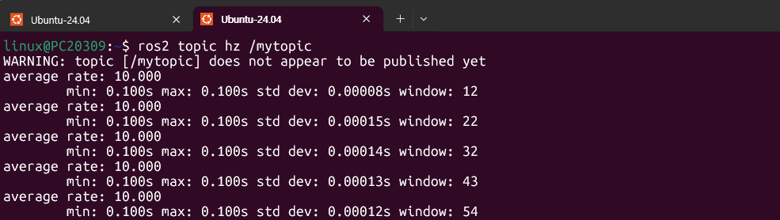

   `average rate`가 10.000이고 `min`, `max`가 모두 0.100s이다.

6. 토픽의 데이터량을 확인한다.

   ```
   $ ros2 topic bw /mytopic
   ```

   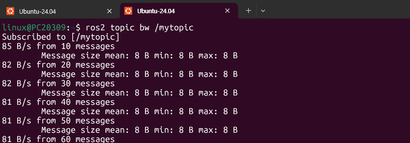

   메시지 크기가 8 B로 고정이고, 초당 데이터량은 85 B/s에서 시작해 81 B/s 부근으로 수렴한다.

### 수신 주기와 주파수 설명

`create_wall_timer(100ms, fn)`으로 100ms마다 콜백이 실행되어 메시지를 1개씩 발행한다. 따라서 **주기는 100ms(0.1초)**, **주파수는 1 / 0.1s = 10 Hz**이다. `ros2 topic hz`의 출력(`average rate: 10.000`, `min`·`max` 0.100s)이 이를 그대로 보여 준다. `std dev`가 약 0.0001초로 매우 작아서 메시지 간격이 거의 일정하게 유지된다.

`ros2 topic bw`에서 메시지 크기는 8 B이다. `Int32`의 데이터는 4바이트이고 나머지 4바이트는 직렬화 과정에서 붙는 값으로 해석했다. 이는 `Int32`(4 B)와 뒤의 `Vector3`(24 B → 28 B), `Twist`(48 B → 52 B) 결과가 모두 4바이트씩 더해진 데서 나온 해석이고, 공식 문서로 따로 확인한 내용은 아니다. 초당 데이터량은 8 B × 10 Hz = 80 B/s이고 출력값 81 B/s와 거의 같다.

---

## 실습과제 2

**예제 1번을 수정하여 키보드로부터 실수값 3개를 입력받아 퍼블리시하는 패키지 pub2-2를 작성하시오. 토픽 메시지 인터페이스는 geometry_msgs/msg/Vector3을 사용할 것. ROS2 명령어로 실행 결과를 확인하라. 토픽메시지의 수신 주기와 주파수를 설명하라.**

패키지 이름은 `pub2_2`로 만들었다. 입력은 프로그램 시작 시 한 번 받고, 받은 값을 100ms마다 계속 발행한다.

### 패키지 생성

의존 패키지를 `std_msgs`에서 `geometry_msgs`로 바꾼다.

```
$ cd ~/ros2_ws/src
$ ros2 pkg create pub2_2 --build-type ament_cmake --dependencies rclcpp geometry_msgs
```

### 소스파일 (`pub2_2/src/pub2_2.cpp`)

```cpp
#include "rclcpp/rclcpp.hpp"
#include "geometry_msgs/msg/vector3.hpp"
#include <memory>
#include <chrono>
#include <functional>
#include <iostream>
using namespace std::chrono_literals;

void callback(rclcpp::Node::SharedPtr node,
              rclcpp::Publisher<geometry_msgs::msg::Vector3>::SharedPtr mypub,
              double x, double y, double z)
{
    auto message = geometry_msgs::msg::Vector3();
    message.x = x;
    message.y = y;
    message.z = z;
    RCLCPP_INFO(node->get_logger(), "Publish: x=%.2f, y=%.2f, z=%.2f",
                message.x, message.y, message.z);
    mypub->publish(message);
}

int main(int argc, char* argv[])
{
    rclcpp::init(argc, argv);

    double x, y, z;
    std::cout << "실수 3개(x y z)를 입력하세요: ";
    std::cin >> x >> y >> z;

    auto node = std::make_shared<rclcpp::Node>("mynode");
    auto qos_profile = rclcpp::QoS(rclcpp::KeepLast(10));
    auto pub = node->create_publisher<geometry_msgs::msg::Vector3>("mytopic", qos_profile);
    std::function<void()> fn = std::bind(callback, node, pub, x, y, z);
    auto timer = node->create_wall_timer(100ms, fn);
    rclcpp::spin(node);
    rclcpp::shutdown();
    return 0;
}
```

### 줄 단위 코드 설명

pub2_1과 같은 줄은 생략하고 달라진 부분만 설명한다.

| 줄 | 코드 | 설명 |
|---|---|---|
| 2 | `#include "geometry_msgs/msg/vector3.hpp"` | `geometry_msgs/msg/Vector3` 인터페이스의 헤더 |
| 6 | `#include <iostream>` | 키보드 입력(`std::cin`)과 출력(`std::cout`)에 필요 |
| 9~11 | `void callback(node, mypub, double x, double y, double z)` | 퍼블리셔 외에 발행할 실수값 3개도 매개변수로 받는다 |
| 13 | `auto message = geometry_msgs::msg::Vector3();` | `Vector3` 메시지 객체 생성 |
| 14~16 | `message.x = x;` 등 | `Vector3`의 `float64` 필드 `x`, `y`, `z`에 값을 채운다 |
| 17~18 | `RCLCPP_INFO(..., "Publish: x=%.2f, y=%.2f, z=%.2f", ...)` | 값을 소수점 둘째 자리까지 로그로 출력 |
| 26 | `double x, y, z;` | 입력받을 실수 3개를 담을 변수 |
| 27 | `std::cout << "실수 3개(x y z)를 입력하세요: ";` | 입력 안내 문구 출력 |
| 28 | `std::cin >> x >> y >> z;` | 공백으로 구분된 실수 3개를 키보드로 입력받는다 |
| 34 | `std::bind(callback, node, pub, x, y, z)` | 입력받은 값 3개까지 함께 묶어 `void()` 형태로 변형한다. 타이머가 호출할 때마다 같은 `x`, `y`, `z`가 발행된다 |

### CMakeLists.txt에서 예제 1과 달라진 부분

| 항목 | 예제 1 | pub2_2 |
|---|---|---|
| `project(...)` | `pub2` | `pub2_2` |
| `find_package(...)` | `std_msgs` | `geometry_msgs` |
| `add_executable(...)` | `pub2 src/pub.cpp` | `pub2_2 src/pub2_2.cpp` |
| `ament_target_dependencies(...)` | `pub2 rclcpp std_msgs` | `pub2_2 rclcpp geometry_msgs` |

### 실습 절차

1. 빌드 후 실행하고 `1.5 2.5 3.5`를 입력한다.

   ```
   $ cd ~/ros2_ws
   $ colcon build --symlink-install --packages-select pub2_2
   $ source install/local_setup.bash
   $ ros2 run pub2_2 pub2_2
   ```

   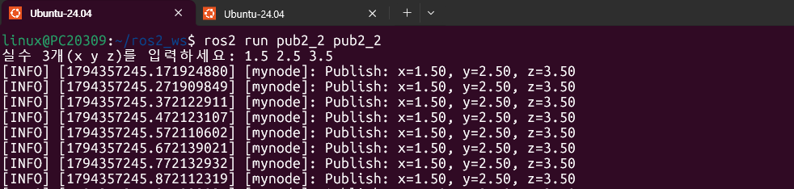

   입력 안내가 나오고 `1.5 2.5 3.5`를 입력하면 `Publish: x=1.50, y=2.50, z=3.50` 로그가 약 0.1초 간격으로 출력된다.

2. `rqt_graph`를 실행한다.

   ```
   $ rqt_graph
   ```

   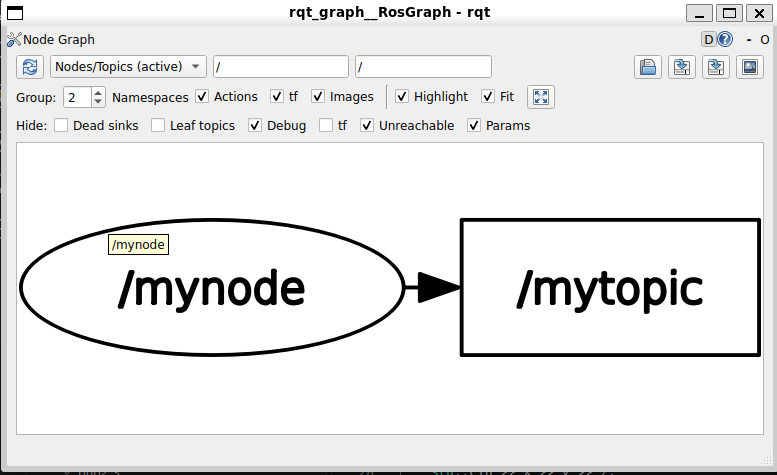

   `/mynode`에서 `/mytopic`으로 이어진다.

3. 패키지, 노드, 토픽 목록을 확인한다.

   ```
   $ ros2 pkg list | grep pub2_2
   $ ros2 node list
   $ ros2 topic list -t
   ```

   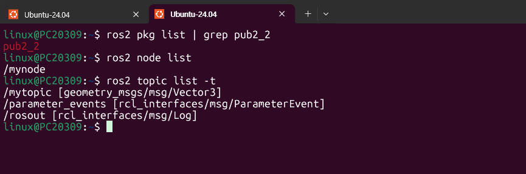

   토픽이 `/mytopic [geometry_msgs/msg/Vector3]`로 나와 메시지 인터페이스가 `Vector3`임을 확인할 수 있다.

4. 토픽의 내용을 출력한다.

   ```
   $ ros2 topic echo /mytopic
   ```

   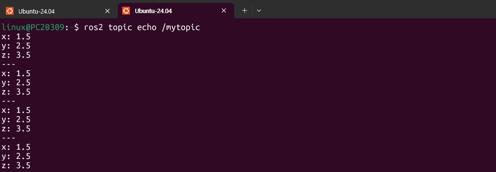

   입력한 `x: 1.5`, `y: 2.5`, `z: 3.5`가 `---` 구분선과 함께 반복해서 나온다.

5. 토픽의 주기와 주파수를 확인한다.

   ```
   $ ros2 topic hz /mytopic
   ```

   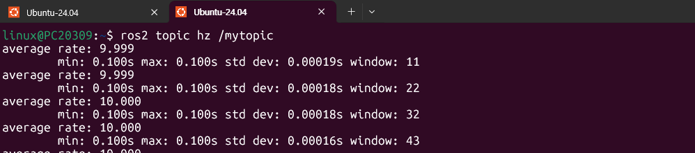

   `average rate`가 9.999~10.000이고 `min`, `max`가 0.100s이다.

6. 토픽의 데이터량을 확인한다.

   ```
   $ ros2 topic bw /mytopic
   ```

   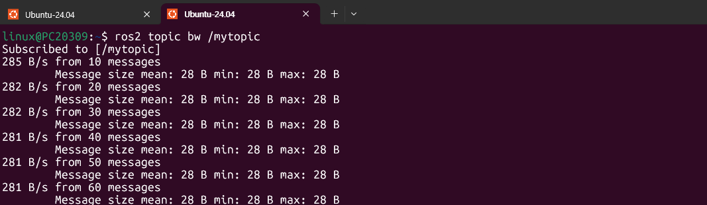

   메시지 크기가 28 B로 고정이고, 초당 데이터량은 285 B/s에서 281 B/s 부근으로 수렴한다.

### 수신 주기와 주파수 설명

키보드 입력은 시작할 때 한 번만 받고, 발행은 pub2_1과 같이 100ms 타이머가 담당한다. 그래서 **주기는 100ms**, **주파수는 10 Hz**이고, `hz` 출력의 `average rate`가 9.999~10.000으로 나온다. 입력한 값은 변하지 않으므로 `echo`에서도 같은 값이 계속 나온다.

메시지 크기는 28 B이다. `Vector3`는 `float64` 3개(24 B)이고 나머지 4 B는 pub2_1과 같은 규칙으로 더해진 값으로 해석했다. 초당 데이터량은 28 B × 10 Hz = 280 B/s이고 출력값 281 B/s와 거의 같다.

---

## 실습과제 3

**Turtlesim 패키지의 teleop_turtle 노드를 대신하는 패키지 pub2-3를 작성하라. 거북이의 선속도와 각속도를 적당한 값으로 전송하여 거북이가 일정한 반경으로 무한히 회전하도록 /turtle1/cmd_vel 토픽을 발행할 것. geometry_msgs/msg/Twist 를 사용할 것. turtlesim(subscriber 역할수행) 노드를 먼저 실행하고 테스트 할 것. ROS2 명령어로 실행 결과를 확인하라. 토픽메시지의 수신 주기와 주파수를 설명하라.**

패키지 이름은 `pub2_3`으로 만들었다. teleop_turtle은 키를 누를 때만 `Twist`를 발행하지만, pub2_3은 타이머로 같은 속도 명령을 계속 발행하여 거북이가 원을 그리며 계속 돌게 한다.

### 패키지 생성

```
$ cd ~/ros2_ws/src
$ ros2 pkg create pub2_3 --build-type ament_cmake --dependencies rclcpp geometry_msgs
```

### 소스파일 (`pub2_3/src/pub2_3.cpp`)

```cpp
#include "rclcpp/rclcpp.hpp"
#include "geometry_msgs/msg/twist.hpp"
#include <memory>
#include <chrono>
#include <functional>
using namespace std::chrono_literals;

void callback(rclcpp::Node::SharedPtr node,
              rclcpp::Publisher<geometry_msgs::msg::Twist>::SharedPtr mypub)
{
    auto message = geometry_msgs::msg::Twist();
    message.linear.x = 2.0;    // 선속도 (m/s)
    message.angular.z = 1.0;   // 각속도 (rad/s)
    RCLCPP_INFO(node->get_logger(), "Publish: linear.x=%.1f, angular.z=%.1f",
                message.linear.x, message.angular.z);
    mypub->publish(message);
}

int main(int argc, char* argv[])
{
    rclcpp::init(argc, argv);
    auto node = std::make_shared<rclcpp::Node>("mynode");
    auto qos_profile = rclcpp::QoS(rclcpp::KeepLast(10));
    auto pub = node->create_publisher<geometry_msgs::msg::Twist>("/turtle1/cmd_vel", qos_profile);
    std::function<void()> fn = std::bind(callback, node, pub);
    auto timer = node->create_wall_timer(100ms, fn);
    rclcpp::spin(node);
    rclcpp::shutdown();
    return 0;
}
```

### 줄 단위 코드 설명

| 줄 | 코드 | 설명 |
|---|---|---|
| 2 | `#include "geometry_msgs/msg/twist.hpp"` | `geometry_msgs/msg/Twist` 인터페이스의 헤더. 클래스명은 `Twist`로 대문자 `T`이다 |
| 9~10 | `void callback(node, mypub)` | `Twist`를 발행하는 콜백함수 |
| 12 | `auto message = geometry_msgs::msg::Twist();` | `Twist` 메시지 객체 생성 |
| 13 | `message.linear.x = 2.0;` | 선속도를 앞 방향으로 2.0으로 설정 |
| 14 | `message.angular.z = 1.0;` | z축 기준 각속도를 1.0으로 설정(반시계 방향 회전). 나머지 필드는 0.0 |
| 15~16 | `RCLCPP_INFO(..., "Publish: linear.x=%.1f, angular.z=%.1f", ...)` | 발행하는 속도 값을 로그로 출력 |
| 17 | `mypub->publish(message);` | `/turtle1/cmd_vel`로 발행 |
| 27 | `create_publisher<geometry_msgs::msg::Twist>("/turtle1/cmd_vel", qos_profile)` | turtlesim이 구독하는 토픽 이름 `/turtle1/cmd_vel`로 퍼블리셔 생성. 이름이 같아야 turtlesim이 메시지를 받는다 |
| 28~29 | `std::bind(callback, node, pub)`, `create_wall_timer(100ms, fn)` | pub2_1과 같이 100ms 주기로 콜백을 호출 |

### 거북이가 원을 그리는 이유

선속도 `v`와 각속도 `ω`를 일정하게 주면 회전 반경은 `r = v / ω`이다. 여기서는 `r = 2.0 / 1.0 = 2.0`이고, 속도 명령이 계속 들어오므로 거북이는 일정한 반경의 원을 따라 무한히 돈다. 발행이 중단되면 거북이가 멈추는지는 따로 확인하지 않았다.

### CMakeLists.txt에서 예제 1과 달라진 부분

| 항목 | 예제 1 | pub2_3 |
|---|---|---|
| `project(...)` | `pub2` | `pub2_3` |
| `find_package(...)` | `std_msgs` | `geometry_msgs` |
| `add_executable(...)` | `pub2 src/pub.cpp` | `pub2_3 src/pub2_3.cpp` |
| `ament_target_dependencies(...)` | `pub2 rclcpp std_msgs` | `pub2_3 rclcpp geometry_msgs` |

### 실습 절차

1. 터미널 1에서 turtlesim을 먼저 실행하고, 터미널 2에서 pub2_3을 실행한다.

   ```
   $ ros2 run turtlesim turtlesim_node
   ```

   ```
   $ cd ~/ros2_ws
   $ colcon build --symlink-install --packages-select pub2_3
   $ source install/local_setup.bash
   $ ros2 run pub2_3 pub2_3
   ```

   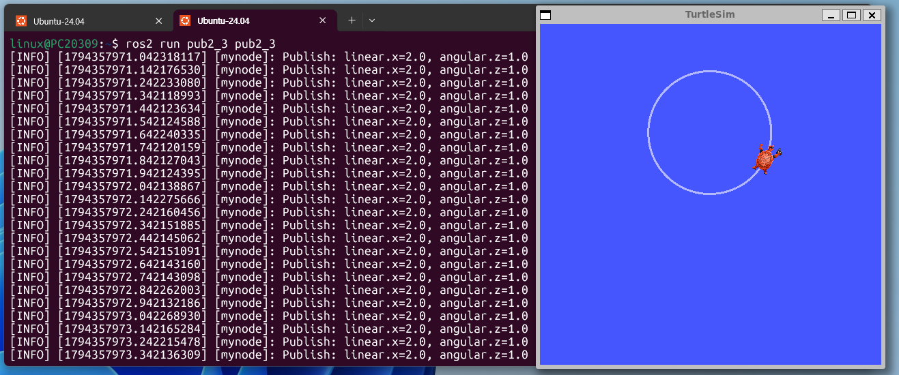

   `Publish: linear.x=2.0, angular.z=1.0` 로그가 약 0.1초마다 출력되고, TurtleSim 창에서 거북이가 원을 그리며 돈다.

2. `rqt_graph`를 실행한다.

   ```
   $ rqt_graph
   ```

   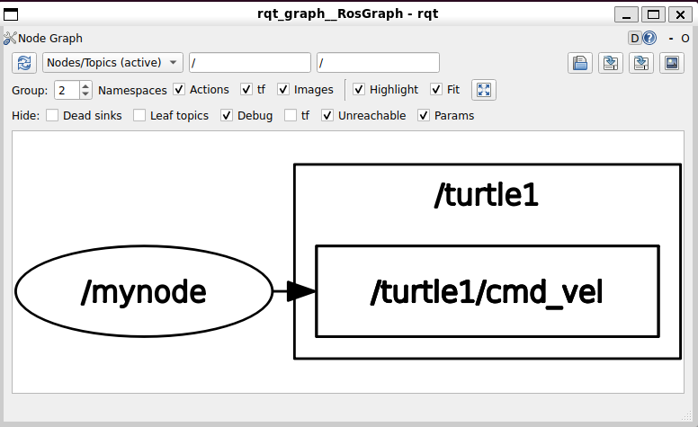

   `/mynode`에서 `/turtle1/cmd_vel`로 이어져 pub2_3이 이 토픽에 발행하고 있음을 보여 준다.

3. 노드와 토픽 목록을 확인한다.

   ```
   $ ros2 node list
   $ ros2 topic list -t
   ```

   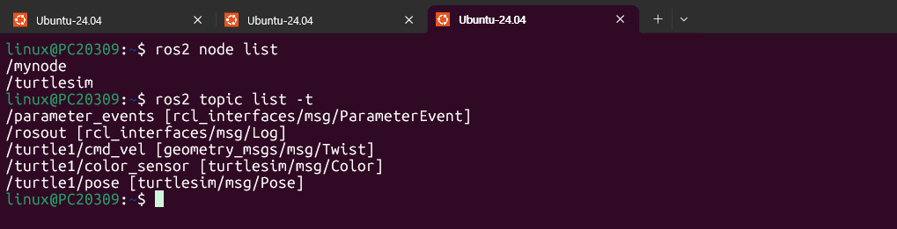

   노드는 `/mynode`(pub2_3)와 `/turtlesim`이 나오고, 토픽은 `/turtle1/cmd_vel [geometry_msgs/msg/Twist]`, `/turtle1/color_sensor [turtlesim/msg/Color]`, `/turtle1/pose [turtlesim/msg/Pose]` 등이 나온다.

4. 토픽의 내용을 출력한다.

   ```
   $ ros2 topic echo /turtle1/cmd_vel
   ```

   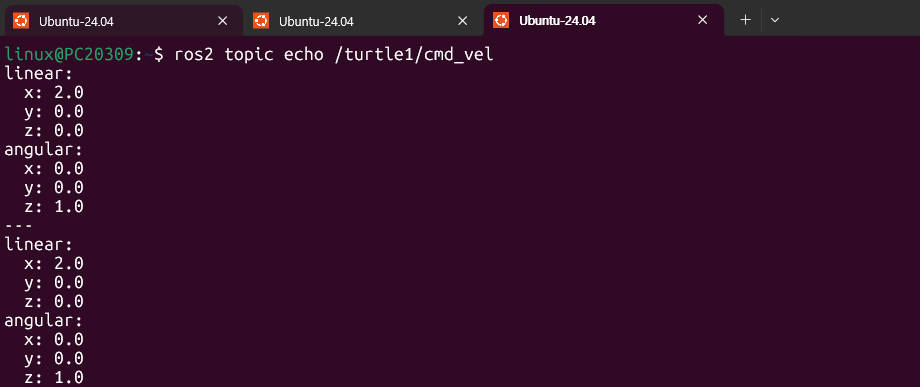

   `linear.x: 2.0`, `angular.z: 1.0`이고 나머지 필드(`linear.y`, `linear.z`, `angular.x`, `angular.y`)는 0.0이다.

5. 토픽의 주기와 주파수를 확인한다.

   ```
   $ ros2 topic hz /turtle1/cmd_vel
   ```

   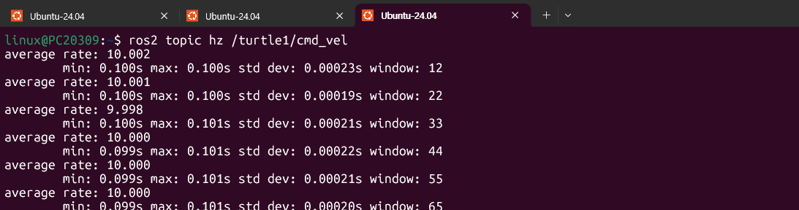

   `average rate`가 9.998~10.002이고 `min`, `max`가 0.099~0.101s이다.

6. 토픽의 데이터량을 확인한다.

   ```
   $ ros2 topic bw /turtle1/cmd_vel
   ```

   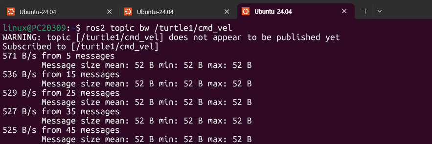

   메시지 크기가 52 B로 고정이고, 초당 데이터량은 571 B/s에서 525 B/s 부근으로 수렴한다.

### 수신 주기와 주파수 설명

pub2_3도 100ms 타이머로 발행하므로 **주기는 100ms**, **주파수는 10 Hz**이다. `hz` 출력에서 `average rate`가 10 Hz 부근으로 나오고, 간격의 최솟값·최댓값이 0.099~0.101초로 거의 같다. 발행하는 값이 같아도 매 주기마다 메시지를 다시 보내므로, 구독자인 `turtlesim`이 속도 명령을 계속 받아 거북이가 멈추지 않고 돈다.

메시지 크기는 52 B이다. `Twist`는 `Vector3` 두 개, 즉 `float64` 6개(48 B)이고 나머지 4 B는 앞의 두 과제와 같은 규칙으로 더해진 값으로 해석했다. 초당 데이터량은 52 B × 10 Hz = 520 B/s이고 출력값 525 B/s와 거의 같다. 처음 571 B/s는 표본이 적어서 생긴 오차이다.

---

## 세 과제 비교

| 구분 | pub2_1 | pub2_2 | pub2_3 |
|---|---|---|---|
| 메시지 인터페이스 | `std_msgs/msg/Int32` | `geometry_msgs/msg/Vector3` | `geometry_msgs/msg/Twist` |
| 토픽 이름 | `/mytopic` | `/mytopic` | `/turtle1/cmd_vel` |
| 발행 값 | 0부터 1씩 증가 | 키보드로 입력한 실수 3개 | `linear.x=2.0`, `angular.z=1.0` |
| 주기 / 주파수 | 100ms / 10 Hz | 100ms / 10 Hz | 100ms / 10 Hz |
| 메시지 크기 | 8 B | 28 B | 52 B |
| 초당 데이터량 | 약 81 B/s | 약 281 B/s | 약 525 B/s |
| 의존 패키지 | `rclcpp`, `std_msgs` | `rclcpp`, `geometry_msgs` | `rclcpp`, `geometry_msgs` |

주기와 주파수는 타이머 설정(100ms)이 결정하므로 세 과제가 같고, 메시지 크기는 인터페이스에 담긴 필드 수에 따라 달라진다. 초당 데이터량은 메시지 크기에 주파수를 곱한 값과 거의 일치한다.
