# 20장. rclcpp Subscription — 실습과제

## 폴더 구성

```
chap_20/
├─ README.md
├─ psub1_1/            # 실습과제 1 패키지 (100ms, String)
│  ├─ CMakeLists.txt
│  └─ src/ (pub.cpp, sub.cpp)
├─ psub1_2/            # 실습과제 2 패키지 (50ms, Int32)
│  ├─ CMakeLists.txt
│  └─ src/ (pub.cpp, sub.cpp)
└─ images/             # 실행 결과 캡처
```

두 패키지 모두 `~/ros2_ws/src` 아래에 만들고, `~/ros2_ws`에서 `colcon build --symlink-install --packages-select <패키지명>`으로 빌드했다. 패키지 이름에는 하이픈 대신 밑줄을 써서 `psub1_1`, `psub1_2`로 작성했다.

---

## 실습과제 1

**예제 1번을 수정하여 타이머를 이용하여 100msec 마다 토픽을 발행하고 구독하는 패키지 psub1-1를 작성하라.**

### 예제 1과 달라진 점

| 구분 | 예제 1 (psub1) | 실습과제 1 (psub1_1) |
|---|---|---|
| 발행 주기 처리 | `while(rclcpp::ok())` 반복문 + `WallRate::sleep()` | `create_wall_timer(100ms, ...)` + `rclcpp::spin()` |
| 발행 코드 위치 | `main` 함수의 반복문 안 | 타이머 콜백 함수 `mypub_callback` |
| 주기 | 1초 | 100ms |
| 노드 이름 | `node_pub1`, `node_sub1` | `node_pub1_1`, `node_sub1_1` |
| 토픽 이름 | `topic_pub1` | `topic_pub1_1` |
| 메시지 인터페이스 | `std_msgs/msg/String` | `std_msgs/msg/String` (동일) |

예제 1의 Publisher는 반복문 안에서 직접 잠들었다가 깨어나 발행했지만, 이번에는 `spin`이 이벤트를 기다리다가 타이머 시간이 되면 콜백 함수를 호출하고 그 안에서 발행한다. Subscriber는 토픽 이름과 노드 이름만 바뀌고 구조는 예제 1과 같다.

### 소스 코드: psub1_1/src/pub.cpp

```cpp
#include "rclcpp/rclcpp.hpp"
#include "std_msgs/msg/string.hpp"
#include <memory>
#include <chrono>
#include <functional>

using namespace std::chrono_literals;

void mypub_callback(rclcpp::Node::SharedPtr node,
                    rclcpp::Publisher<std_msgs::msg::String>::SharedPtr pub)
{
    std_msgs::msg::String message;
    message.data = "Hello world!";
    RCLCPP_INFO(node->get_logger(), "Publish: %s", message.data.c_str());
    pub->publish(message);
}

int main(int argc, char * argv[])
{
    rclcpp::init(argc, argv);
    auto node = std::make_shared<rclcpp::Node>("node_pub1_1");
    auto qos_profile = rclcpp::QoS(rclcpp::KeepLast(10));
    auto mypub = node->create_publisher<std_msgs::msg::String>("topic_pub1_1", qos_profile);
    std::function<void()> fn = std::bind(mypub_callback, node, mypub);
    auto timer = node->create_wall_timer(100ms, fn);
    rclcpp::spin(node);
    rclcpp::shutdown();
    return 0;
}
```

| 줄 | 설명 |
|---|---|
| 1 | ROS 2 C++ 클라이언트 라이브러리(rclcpp)의 헤더. 노드, Publisher, 타이머, 로그 매크로가 모두 여기에 들어 있다. |
| 2 | 문자열 메시지 인터페이스 `std_msgs/msg/String`의 헤더. 클래스 이름은 `std_msgs::msg::String`이다. |
| 3~5 | `std::make_shared`, `std::shared_ptr`용 `<memory>`, 시간 단위용 `<chrono>`, `std::function`·`std::bind`용 `<functional>`. |
| 7 | `100ms`처럼 숫자 뒤에 시간 단위를 붙이는 리터럴을 쓰기 위한 선언. |
| 9~10 | 타이머가 호출할 콜백 함수. 노드 포인터와 Publisher 포인터를 매개변수로 받는다. `rclcpp::Publisher<...>::SharedPtr`는 `std::shared_ptr<rclcpp::Publisher<...>>`와 같은 표기이다. |
| 12 | 발행할 메시지 객체를 만든다. |
| 13 | 메시지의 `data` 필드에 문자열 `"Hello world!"`를 넣는다. |
| 14 | 노드의 logger로 `Publish: Hello world!` 로그를 출력한다. `%s`에는 `c_str()`로 C 문자열을 넘긴다. |
| 15 | `publish`로 토픽 메시지를 발행한다. |
| 18~20 | `main` 함수 시작과 `rclcpp::init`. ROS 2 초기화이므로 가장 먼저 호출한다. |
| 21 | `node_pub1_1`이라는 이름의 노드를 만든다. |
| 22 | 통신 품질 설정. `KeepLast(10)`은 최근 메시지 10개까지 큐에 보관한다는 뜻이다. |
| 23 | `topic_pub1_1` 토픽에 `String` 메시지를 발행하는 Publisher를 만든다. |
| 24 | 콜백 함수는 인자 없는 `void()` 형태여야 하므로, `std::bind`로 `node`와 `mypub`을 미리 묶어 인자가 없는 함수 `fn`으로 바꾼다. |
| 25 | 100ms마다 `fn`을 호출하는 타이머를 만든다. 반환된 `timer`를 변수에 저장해 `spin`이 도는 동안 유지한다. |
| 26 | `spin`이 노드를 계속 실행하며 타이머 이벤트가 생기면 콜백을 호출한다. Ctrl+C가 입력되면 반환한다. |
| 27~29 | 종료 작업(`shutdown`)을 하고 프로그램을 끝낸다. |

### 소스 코드: psub1_1/src/sub.cpp

```cpp
#include "rclcpp/rclcpp.hpp"
#include "std_msgs/msg/string.hpp"
#include <memory>
#include <functional>

void mysub_callback(rclcpp::Node::SharedPtr node,
                    const std_msgs::msg::String::SharedPtr msg)
{
    RCLCPP_INFO(node->get_logger(), "Received message: %s", msg->data.c_str());
}

int main(int argc, char* argv[])
{
    rclcpp::init(argc, argv);
    auto node = std::make_shared<rclcpp::Node>("node_sub1_1");
    auto qos_profile = rclcpp::QoS(rclcpp::KeepLast(10));
    std::function<void(const std_msgs::msg::String::SharedPtr)> fn =
        std::bind(mysub_callback, node, std::placeholders::_1);
    auto mysub = node->create_subscription<std_msgs::msg::String>("topic_pub1_1", qos_profile, fn);
    rclcpp::spin(node);
    rclcpp::shutdown();
    return 0;
}
```

| 줄 | 설명 |
|---|---|
| 1~4 | rclcpp, `String` 메시지, `<memory>`, `<functional>` 헤더. |
| 6~7 | 토픽 메시지를 받았을 때 호출되는 콜백 함수. 노드 포인터와 수신한 메시지 포인터를 받는다. |
| 9 | 수신한 메시지의 `data`를 `Received message: ...` 형식으로 출력한다. 포인터이므로 `msg->data`로 접근한다. |
| 12~14 | `main` 함수 시작과 `rclcpp::init`. |
| 15 | `node_sub1_1` 노드를 만든다. |
| 16 | 통신 품질 설정(`KeepLast(10)`). Publisher와 같은 값을 쓴다. |
| 17~18 | `create_subscription`의 콜백은 `void(MessageT::SharedPtr)` 형태만 받는다. 콜백이 매개변수 2개(`node`, `msg`)이므로 `std::bind`로 `node`를 묶고 `msg` 자리는 `std::placeholders::_1`로 남겨 1개짜리 함수 `fn`을 만든다. |
| 19 | `topic_pub1_1` 토픽을 구독하는 Subscription 객체를 만들고 수신 콜백으로 `fn`을 등록한다. |
| 20 | `spin`으로 토픽 수신 이벤트를 기다리고, 메시지가 도착하면 콜백을 호출한다. |
| 21~23 | 종료 작업을 하고 프로그램을 끝낸다. |

### 소스 코드: psub1_1/CMakeLists.txt

```cmake
cmake_minimum_required(VERSION 3.16)
project(psub1_1)

if(NOT CMAKE_CXX_STANDARD)
  set(CMAKE_CXX_STANDARD 14)
endif()

if(CMAKE_COMPILER_IS_GNUCXX OR CMAKE_CXX_COMPILER_ID MATCHES "Clang")
  add_compile_options(-Wall -Wextra -Wpedantic)
endif()

find_package(ament_cmake REQUIRED)
find_package(rclcpp REQUIRED)
find_package(std_msgs REQUIRED)

add_executable(pub src/pub.cpp)
ament_target_dependencies(pub rclcpp std_msgs)

add_executable(sub src/sub.cpp)
ament_target_dependencies(sub rclcpp std_msgs)

install(TARGETS pub sub DESTINATION lib/${PROJECT_NAME})

ament_package()
```

| 줄 | 설명 |
|---|---|
| 1 | 필요한 CMake 최소 버전. |
| 2 | 패키지 이름을 `psub1_1`로 지정한다. |
| 4~6 | C++ 표준이 지정되지 않았으면 C++14를 사용한다. |
| 8~10 | GCC나 Clang이면 경고 옵션(`-Wall -Wextra -Wpedantic`)을 켠다. |
| 12~14 | 의존 패키지 `ament_cmake`, `rclcpp`, `std_msgs`를 찾는다. |
| 16~17 | `src/pub.cpp`로 실행파일 `pub`을 만들고 `rclcpp`, `std_msgs`를 링크한다. |
| 19~20 | `src/sub.cpp`로 실행파일 `sub`을 만들고 같은 라이브러리를 링크한다. |
| 22 | 빌드된 `pub`, `sub`를 `install/psub1_1/lib/psub1_1`에 설치한다. `ros2 run`이 이 경로의 실행파일을 찾는다. |
| 24 | ament 패키지 설정을 마무리한다. 항상 마지막 줄에 둔다. |

### 실습 절차

1. 패키지를 만들고 소스파일을 작성한 뒤 폴더 구조를 확인한다.

   ```
   cd ~/ros2_ws/src
   ros2 pkg create psub1_1 --build-type ament_cmake --dependencies rclcpp std_msgs
   tree psub1_1
   ```

   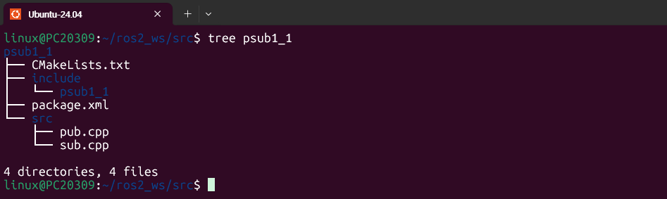

   `src` 아래에 작성한 `pub.cpp`, `sub.cpp`가 있고, 패키지 생성 때 만들어진 `CMakeLists.txt`, `package.xml`, `include/psub1_1`이 보인다.

2. 워크스페이스에서 빌드한다.

   ```
   cd ~/ros2_ws
   colcon build --symlink-install --packages-select psub1_1
   source install/local_setup.bash
   ```

   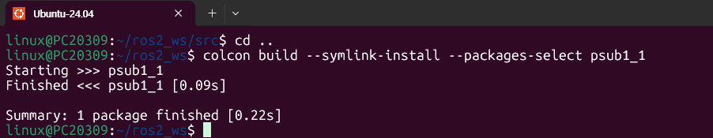

   `Finished <<< psub1_1`로 빌드가 오류 없이 끝났다. 이 캡처는 소스를 작성하고 한 번 빌드한 뒤 다시 실행한 화면이라 소요 시간이 짧게(0.09s) 나온다.

3. 터미널 1에서 Publisher 노드를 실행한다.

   ```
   ros2 run psub1_1 pub
   ```

   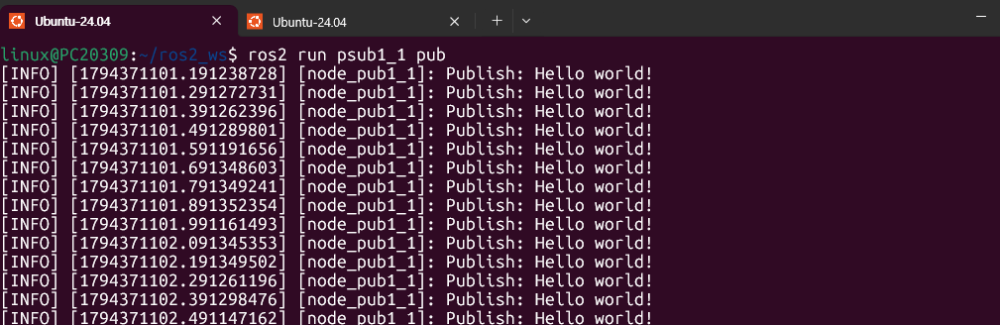

   `Publish: Hello world!` 로그가 계속 출력된다. 로그 앞 타임스탬프가 `...101.191`, `...101.291`, `...101.391`처럼 0.1초씩 늘어나므로 100ms 주기로 발행되고 있다.

4. 터미널 2에서 Subscriber 노드를 실행한다.

   ```
   ros2 run psub1_1 sub
   ```

   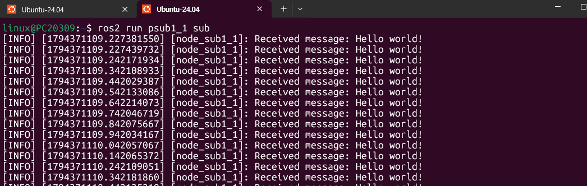

   `Received message: Hello world!`가 같은 100ms 간격으로 출력된다. Publisher가 발행한 메시지를 Subscriber가 받고 있다.

5. 터미널 3에서 노드 연결 구조를 확인한다.

   ```
   rqt_graph
   ```

   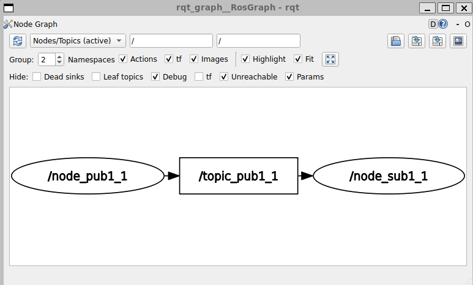

   `/node_pub1_1` → `/topic_pub1_1` → `/node_sub1_1` 구조이다. 발행 노드가 토픽으로 메시지를 보내고 구독 노드가 그 토픽을 받는다.

6. 노드 목록, 토픽 목록(메시지 인터페이스 포함), 토픽 데이터를 확인한다.

   ```
   ros2 node list
   ros2 topic list -t
   ros2 topic echo /topic_pub1_1
   ```

   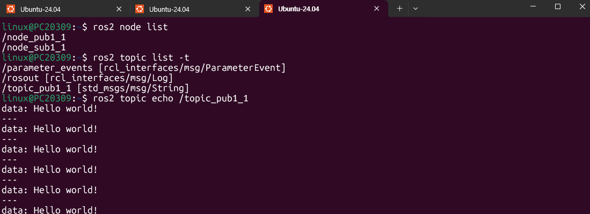

   `ros2 node list`에 `/node_pub1_1`, `/node_sub1_1`이 나오고, `ros2 topic list -t`에서 `/topic_pub1_1`의 인터페이스가 `std_msgs/msg/String`으로 확인된다. `/parameter_events`와 `/rosout`은 ROS 2가 기본으로 만드는 토픽이다. `echo`로는 `data: Hello world!`가 `---` 구분선과 함께 반복해서 보인다.

7. 토픽 발행 주기를 확인한다.

   ```
   ros2 topic hz /topic_pub1_1
   ```

   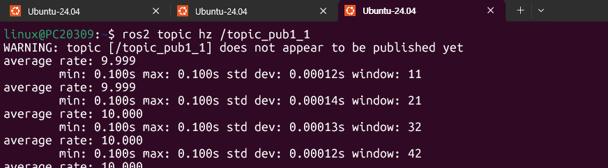

   `average rate`가 9.999~10.000이고 `min`, `max`가 모두 0.100s이다. 100ms 간격이므로 초당 10번 발행된다. 맨 위의 `WARNING`은 명령 시작 직후 표시된 경고이고, 이후에는 정상 값이 계속 출력되었다.

8. 토픽 대역폭을 확인한다.

   ```
   ros2 topic bw /topic_pub1_1
   ```

   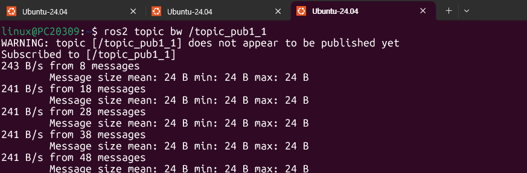

   메시지 크기는 24 B로 일정하고, 초당 10개를 발행하므로 약 241 B/s가 측정되었다(24 B × 10 ≈ 240 B/s). `String` 메시지의 크기는 문자열 길이만이 아니라 직렬화에 필요한 추가 바이트를 포함한 값이다.

### 출력 결과 설명

| 확인 항목 | 캡처에서 나온 값 | 의미 |
|---|---|---|
| 발행/수신 로그 간격 | 약 0.1초 | `create_wall_timer(100ms)`가 정상 동작 |
| 노드 | `/node_pub1_1`, `/node_sub1_1` | Publisher, Subscriber 두 노드 실행 중 |
| 토픽과 인터페이스 | `/topic_pub1_1 [std_msgs/msg/String]` | 문자열 메시지 인터페이스 사용 |
| 발행 주기 | 약 10 Hz (min = max = 0.100s) | 100ms 주기가 매우 일정함 |
| 메시지 크기 / 대역폭 | 24 B / 약 241 B/s | 24 B × 10개/s |

---

## 실습과제 2

**예제1번을 수정하여 타이머를 이용하여 50msec마다 정수 값을 0부터 1씩 증가시키면서 발행하고 구독하는 패키지 psub1-2를 작성하라.**

### 실습과제 1과 달라진 점

| 구분 | 실습과제 1 (psub1_1) | 실습과제 2 (psub1_2) |
|---|---|---|
| 타이머 주기 | 100ms | 50ms |
| 메시지 인터페이스 | `std_msgs/msg/String` | `std_msgs/msg/Int32` |
| 헤더 파일 / 클래스명 | `std_msgs/msg/string.hpp` / `std_msgs::msg::String` | `std_msgs/msg/int32.hpp` / `std_msgs::msg::Int32` |
| 발행 값 | 고정 문자열 `"Hello world!"` | 0부터 1씩 증가하는 정수 |
| 로그 형식 지정자 | `%s` | `%d` |
| 노드 / 토픽 이름 | `node_pub1_1`, `node_sub1_1` / `topic_pub1_1` | `node_pub1_2`, `node_sub1_2` / `topic_pub1_2` |

### 소스 코드: psub1_2/src/pub.cpp

```cpp
#include "rclcpp/rclcpp.hpp"
#include "std_msgs/msg/int32.hpp"
#include <memory>
#include <chrono>
#include <functional>

using namespace std::chrono_literals;

void mypub_callback(rclcpp::Node::SharedPtr node,
                    rclcpp::Publisher<std_msgs::msg::Int32>::SharedPtr pub)
{
    static int count = 0;
    std_msgs::msg::Int32 message;
    message.data = count++;
    RCLCPP_INFO(node->get_logger(), "Publish: %d", message.data);
    pub->publish(message);
}

int main(int argc, char * argv[])
{
    rclcpp::init(argc, argv);
    auto node = std::make_shared<rclcpp::Node>("node_pub1_2");
    auto qos_profile = rclcpp::QoS(rclcpp::KeepLast(10));
    auto mypub = node->create_publisher<std_msgs::msg::Int32>("topic_pub1_2", qos_profile);
    std::function<void()> fn = std::bind(mypub_callback, node, mypub);
    auto timer = node->create_wall_timer(50ms, fn);
    rclcpp::spin(node);
    rclcpp::shutdown();
    return 0;
}
```

psub1_1과 구조가 같으므로 달라진 줄만 설명한다.

| 줄 | 설명 |
|---|---|
| 2 | `Int32` 메시지 인터페이스의 헤더로 바꾼다. 클래스 이름은 `std_msgs::msg::Int32`이다. |
| 10 | 콜백이 받는 Publisher의 자료형도 `Publisher<std_msgs::msg::Int32>`로 바꾼다. |
| 12 | `static int count = 0;` 함수 안의 `static` 변수는 처음 한 번만 0으로 초기화되고, 콜백이 다시 호출되어도 값이 유지된다. 호출 횟수를 세는 카운터로 쓴다. |
| 13~14 | `Int32` 메시지의 `data`에 `count`를 넣고 나서 `count`를 1 증가시킨다(`count++`). 그래서 첫 발행 값은 0이고, 이후 1씩 증가한다. |
| 15 | 정수를 출력하므로 형식 지정자를 `%d`로 쓴다. |
| 24 | `topic_pub1_2` 토픽에 `Int32` 메시지를 발행하는 Publisher를 만든다. |
| 26 | 타이머 주기를 `50ms`로 바꾼다. |

### 소스 코드: psub1_2/src/sub.cpp

```cpp
#include "rclcpp/rclcpp.hpp"
#include "std_msgs/msg/int32.hpp"
#include <memory>
#include <functional>

void mysub_callback(rclcpp::Node::SharedPtr node,
                    const std_msgs::msg::Int32::SharedPtr msg)
{
    RCLCPP_INFO(node->get_logger(), "Received message: %d", msg->data);
}

int main(int argc, char* argv[])
{
    rclcpp::init(argc, argv);
    auto node = std::make_shared<rclcpp::Node>("node_sub1_2");
    auto qos_profile = rclcpp::QoS(rclcpp::KeepLast(10));
    std::function<void(const std_msgs::msg::Int32::SharedPtr)> fn =
        std::bind(mysub_callback, node, std::placeholders::_1);
    auto mysub = node->create_subscription<std_msgs::msg::Int32>("topic_pub1_2", qos_profile, fn);
    rclcpp::spin(node);
    rclcpp::shutdown();
    return 0;
}
```

| 줄 | 설명 |
|---|---|
| 2 | `Int32` 메시지 헤더 `std_msgs/msg/int32.hpp`로 바꾼다. |
| 7 | 콜백이 받는 메시지 자료형을 `std_msgs::msg::Int32::SharedPtr`로 바꾼다. |
| 9 | 수신한 정수 `msg->data`를 `%d`로 출력한다. |
| 15 | 노드 이름은 `node_sub1_2`이다. |
| 17~19 | `std::function`의 자료형, `create_subscription`의 템플릿 인자를 모두 `Int32`로 바꾸고 `topic_pub1_2` 토픽을 구독한다. `std::bind`로 매개변수를 줄이는 방법은 psub1_1과 같다. |

### 소스 코드: psub1_2/CMakeLists.txt

psub1_1의 `CMakeLists.txt`에서 2번째 줄의 `project(psub1_1)`만 `project(psub1_2)`로 바꾸면 된다. 나머지 줄(실행파일 `pub`, `sub` 생성, 링크, 설치)은 동일하다.

### 실습 절차

1. 패키지를 만들고 소스파일을 작성한 뒤 폴더 구조를 확인한다.

   ```
   cd ~/ros2_ws/src
   ros2 pkg create psub1_2 --build-type ament_cmake --dependencies rclcpp std_msgs
   tree psub1_2
   ```

   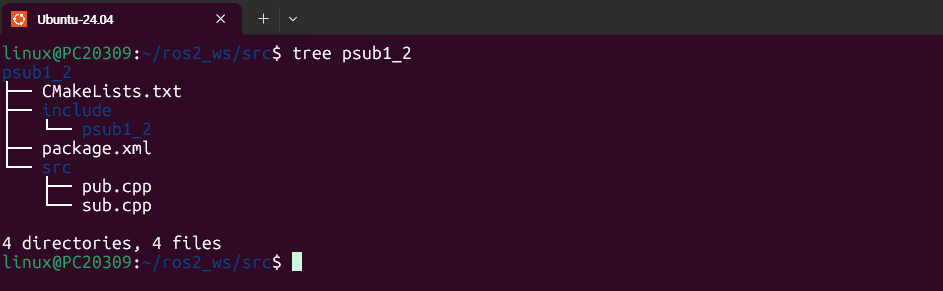

   `psub1_2` 패키지의 `src` 아래에 `pub.cpp`, `sub.cpp`가 만들어져 있다.

2. 워크스페이스에서 빌드한다.

   ```
   cd ~/ros2_ws
   colcon build --symlink-install --packages-select psub1_2
   source install/local_setup.bash
   ```

   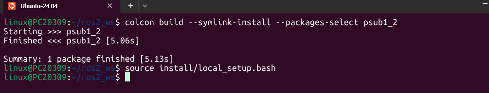

   `Finished <<< psub1_2 [5.06s]`로 오류 없이 빌드되었다.

3. 터미널 1에서 Publisher 노드를 실행한다.

   ```
   ros2 run psub1_2 pub
   ```

   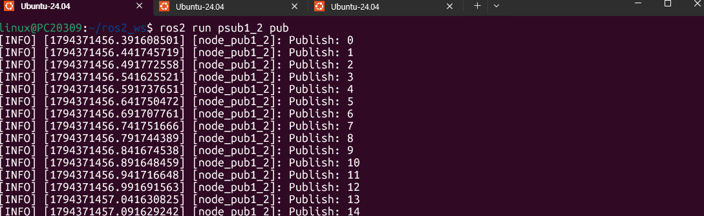

   `Publish: 0`, `Publish: 1`, `Publish: 2`, ...처럼 0부터 1씩 증가하는 값이 발행된다. 타임스탬프가 `...456.391`, `...456.441`, `...456.491`로 0.05초씩 늘어나므로 50ms 주기이다.

4. 터미널 2에서 Subscriber 노드를 실행한다.

   ```
   ros2 run psub1_2 sub
   ```

   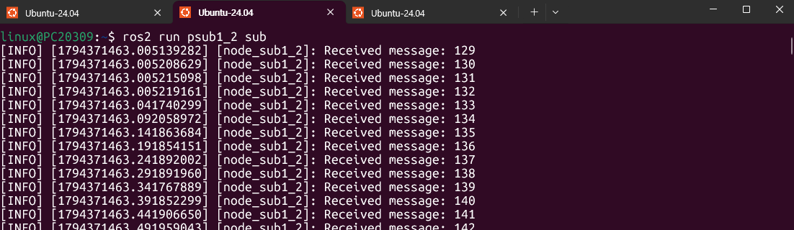

   Subscriber를 Publisher보다 나중에 실행했기 때문에 수신 값이 0이 아니라 129부터 시작한다. 이후 130, 131, ...로 값이 하나씩 빠짐없이 증가하며 50ms 간격으로 출력된다. 맨 처음 몇 개(129~132)는 타임스탬프가 거의 같은데, 구독을 시작한 직후 한꺼번에 도착해 출력된 것이다.

5. 터미널 3에서 노드 연결 구조를 확인한다.

   ```
   rqt_graph
   ```

   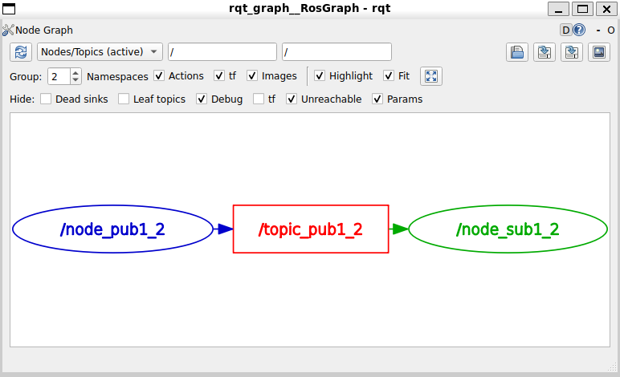

   `/node_pub1_2` → `/topic_pub1_2` → `/node_sub1_2` 구조이다. 이 캡처에서는 노드와 토픽이 색으로 강조된 상태로 보인다.

6. 노드 목록, 토픽 목록(메시지 인터페이스 포함), 토픽 데이터를 확인한다.

   ```
   ros2 node list
   ros2 topic list -t
   ros2 topic echo /topic_pub1_2
   ```

   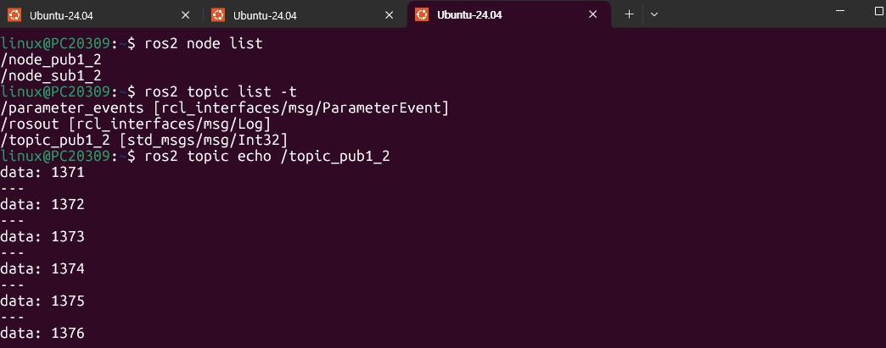

   `/topic_pub1_2`의 인터페이스가 `std_msgs/msg/Int32`로 바뀐 것을 확인할 수 있다. `echo`에는 `data: 1371`, `1372`, ...처럼 정수가 1씩 증가하며 나온다. 이 화면은 Publisher를 켠 지 시간이 지난 뒤에 찍어서 값이 1371부터 보인다.

7. 토픽 발행 주기를 확인한다.

   ```
   ros2 topic hz /topic_pub1_2
   ```

   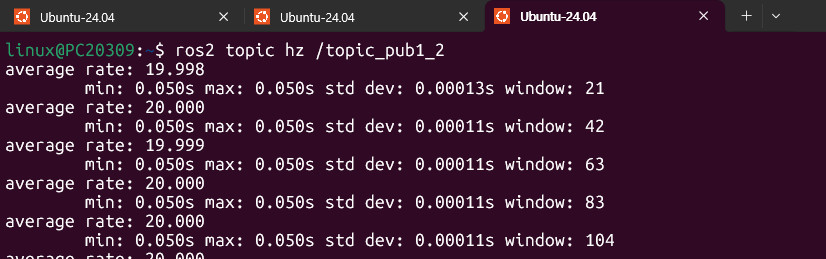

   `average rate`가 19.998~20.000이고 `min`, `max`가 모두 0.050s이다. 50ms 간격이므로 초당 20번 발행된다.

8. 토픽 대역폭을 확인한다.

   ```
   ros2 topic bw /topic_pub1_2
   ```

   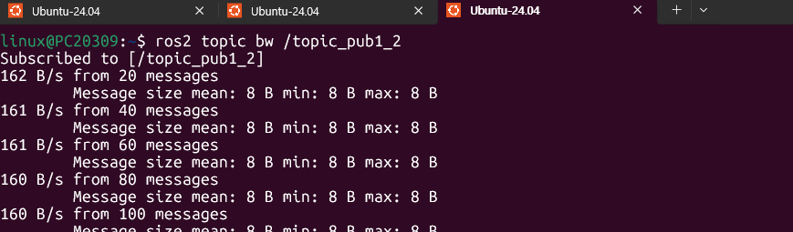

   메시지 크기는 8 B로 일정하고, 초당 20개를 발행하므로 약 160 B/s이다(8 B × 20 = 160 B/s). 같은 토픽 구조에서 `String`(24 B)보다 `Int32`가 더 작은 이유는 담는 데이터가 정수 하나뿐이기 때문이다. 8 B는 `int32` 값 4 B에 직렬화용 추가 바이트가 더해진 크기로 해석된다(필드 이름을 바탕으로 한 해석).

### 출력 결과 설명

| 확인 항목 | 캡처에서 나온 값 | 의미 |
|---|---|---|
| 발행 값 | 0, 1, 2, ... | 콜백이 호출될 때마다 `count`가 1씩 증가 |
| 로그 간격 | 약 0.05초 | `create_wall_timer(50ms)`가 정상 동작 |
| 토픽과 인터페이스 | `/topic_pub1_2 [std_msgs/msg/Int32]` | 정수 메시지 인터페이스 사용 |
| 발행 주기 | 약 20 Hz (min = max = 0.050s) | 50ms 주기가 매우 일정함 |
| 메시지 크기 / 대역폭 | 8 B / 약 160 B/s | 8 B × 20개/s |

---

## 정리

| 구분 | psub1_1 | psub1_2 |
|---|---|---|
| 타이머 주기 / 주파수 | 100ms / 10 Hz | 50ms / 20 Hz |
| 메시지 인터페이스 | `std_msgs/msg/String` | `std_msgs/msg/Int32` |
| 발행 내용 | `"Hello world!"` | 0부터 1씩 증가하는 정수 |
| 메시지 크기 | 24 B | 8 B |
| 대역폭 | 약 241 B/s | 약 160 B/s |

두 패키지 모두 예제 1의 반복문 방식 대신 `create_wall_timer`와 `rclcpp::spin`을 사용해 정해진 주기마다 콜백 함수에서 토픽을 발행하도록 바꾸었고, `ros2 topic hz`로 목표 주기(10 Hz, 20 Hz)가 맞게 나오는 것을 확인했다.
