# 21장. 클래스를 이용한 패키지 작성 — 실습과제

두 패키지 모두 노드의 모든 기능을 클래스로 작성했다. `Pub`, `Sub` 클래스가 `rclcpp::Node`를 상속받고, 생성자에서 노드명(`mypub`, `mysub`)을 기본 클래스 생성자에 전달한다. 메인함수는 노드 객체를 만들어 `spin`만 한다. 헤더파일은 `<패키지명>/include/<패키지명>`, 소스파일은 `<패키지명>/src`에 둔다.

소스파일은 이 폴더의 `psub2_1/`, `psub2_2/`에 있다.

```
psub2_N/
├─ CMakeLists.txt
├─ include/psub2_N/
│  ├─ pub.hpp
│  └─ sub.hpp
└─ src/
   ├─ pub.cpp
   ├─ pmain.cpp
   ├─ sub.cpp
   └─ smain.cpp
```

---

## 실습과제 1

**예제1번을 수정하여 타이머를 이용하여 50msec마다 정수 값을 0부터 1씩 증가시키면서 발행하고 구독하는 패키지 psub2-1를 작성하라. 토픽 메시지 인터페이스는 std_msgs/msg/Int32을 사용할 것.**

ROS 2 패키지 이름에는 하이픈(`-`)을 쓸 수 없어서 패키지명은 `psub2_1`로 했다. 예제 1과 다른 점은 세 가지이다. 메시지 인터페이스를 `std_msgs/msg/String`에서 `std_msgs/msg/Int32`로 바꿨고, 타이머 주기를 `1s`에서 `50ms`로 바꿨고, 카운터가 문자열을 만드는 대신 `Int32`의 `data` 필드에 그대로 들어간다.

### 소스파일과 코드 설명

#### include/psub2_1/pub.hpp

```cpp
#ifndef _PUB_HPP_
#define _PUB_HPP_
#include "rclcpp/rclcpp.hpp"
#include "std_msgs/msg/int32.hpp"
#include <memory>
#include <chrono>
using namespace std::chrono_literals;
class Pub : public rclcpp::Node
{
private:
    rclcpp::TimerBase::SharedPtr timer_;
    rclcpp::Publisher<std_msgs::msg::Int32>::SharedPtr pub_;
    int32_t count_;
    void publish_msg();
public:
    Pub();
};
#endif //_PUB_HPP_
```

- `#ifndef`, `#define`, `#endif`: 헤더파일이 여러 번 포함되어도 클래스가 중복 선언되지 않게 하는 가드이다.
- `#include "rclcpp/rclcpp.hpp"`: `rclcpp::Node` 등 ROS 2 C++ 클라이언트 라이브러리를 가져온다.
- `#include "std_msgs/msg/int32.hpp"`: 메시지 인터페이스 `Int32`의 헤더이다. 예제 1의 `string.hpp`를 바꾼 부분이다.
- `#include <memory>`, `<chrono>`: 스마트 포인터와 시간 단위를 쓰기 위한 표준 헤더이다.
- `using namespace std::chrono_literals;`: `50ms`처럼 숫자 뒤에 시간 단위를 붙여 쓸 수 있게 한다.
- `class Pub : public rclcpp::Node`: `Node`를 상속받아 `Pub` 자체가 노드가 된다.
- `timer_`: 주기적으로 `publish_msg()`를 호출할 타이머의 포인터이다.
- `pub_`: `Int32` 메시지를 발행하는 퍼블리셔의 포인터이다.
- `int32_t count_;`: 0부터 증가시킬 카운터이다. 메시지 필드 `Int32::data`가 32비트 정수이므로 같은 자료형으로 맞췄다.
- `void publish_msg();`: 타이머가 호출할 멤버함수이다. 외부에서 부를 필요가 없어 `private`이다.
- `Pub();`: 생성자이다.

#### src/pub.cpp

```cpp
#include "psub2_1/pub.hpp"

Pub::Pub() : Node("mypub"), count_(0)
{
    auto qos_profile = rclcpp::QoS(rclcpp::KeepLast(10));
    pub_ = this->create_publisher<std_msgs::msg::Int32>("mytopic", qos_profile);
    timer_ = this->create_wall_timer(50ms, std::bind(&Pub::publish_msg, this));
}

void Pub::publish_msg()
{
    auto msg = std_msgs::msg::Int32();
    msg.data = count_++;
    RCLCPP_INFO(this->get_logger(), "Published message: '%d'", msg.data);
    pub_->publish(msg);
}
```

- `Pub::Pub() : Node("mypub"), count_(0)`: 기본 클래스 생성자에 노드명 `mypub`을 전달하고, 카운터를 0으로 초기화한다.
- `rclcpp::QoS(rclcpp::KeepLast(10))`: 최근 메시지 10개까지 보관하는 QoS 설정이다.
- `create_publisher<std_msgs::msg::Int32>("mytopic", qos_profile)`: `mytopic` 토픽으로 `Int32` 메시지를 발행하는 퍼블리셔를 만든다.
- `create_wall_timer(50ms, std::bind(&Pub::publish_msg, this))`: 50ms마다 `publish_msg()`를 호출하는 타이머를 만든다. 멤버함수는 객체가 있어야 호출할 수 있어서 `std::bind`로 `this`를 같이 묶는다.
- `auto msg = std_msgs::msg::Int32();`: 발행할 메시지 객체를 만든다.
- `msg.data = count_++;`: 현재 카운터 값을 메시지에 넣고, 그 뒤에 카운터를 1 증가시킨다. 그래서 첫 메시지가 0이 된다.
- `RCLCPP_INFO(...)`: 발행하는 값을 터미널에 출력한다. `%d`는 정수 출력이다.
- `pub_->publish(msg);`: 메시지를 토픽으로 발행한다.

#### include/psub2_1/sub.hpp

```cpp
#ifndef _SUB_HPP_
#define _SUB_HPP_
#include "rclcpp/rclcpp.hpp"
#include "std_msgs/msg/int32.hpp"
#include <functional>
#include <memory>
using std::placeholders::_1;
class Sub : public rclcpp::Node
{
private:
    rclcpp::Subscription<std_msgs::msg::Int32>::SharedPtr sub_;
    void subscribe_msg(const std_msgs::msg::Int32::SharedPtr msg) const;
public:
    Sub();
};
#endif //_SUB_HPP_
```

- `#include <functional>`: `std::bind`를 쓰기 위한 헤더이다.
- `using std::placeholders::_1;`: 콜백이 받는 첫 번째 인자(수신한 메시지)를 `std::bind`에서 `_1`로 표현하기 위한 선언이다.
- `sub_`: `Int32` 메시지를 구독하는 서브스크립션의 포인터이다.
- `subscribe_msg(...) const`: 메시지를 받을 때 호출되는 콜백이다. 멤버변수를 바꾸지 않으므로 `const`이다.

#### src/sub.cpp

```cpp
#include "psub2_1/sub.hpp"

void Sub::subscribe_msg(const std_msgs::msg::Int32::SharedPtr msg) const
{
    RCLCPP_INFO(this->get_logger(), "Received message: '%d'", msg->data);
}

Sub::Sub() : Node("mysub")
{
    auto qos_profile = rclcpp::QoS(rclcpp::KeepLast(10));
    sub_ = this->create_subscription<std_msgs::msg::Int32>("mytopic", qos_profile,
        std::bind(&Sub::subscribe_msg, this, _1));
}
```

- `msg->data`: 수신한 메시지의 정수 값이다. 포인터로 받으므로 `->`를 쓴다.
- `Node("mysub")`: 노드명을 `mysub`으로 정한다.
- `create_subscription<std_msgs::msg::Int32>("mytopic", qos_profile, ...)`: 퍼블리셔와 같은 토픽 이름과 같은 자료형으로 구독한다. 토픽 이름과 인터페이스가 같아야 연결된다.
- `std::bind(&Sub::subscribe_msg, this, _1)`: 메시지가 도착하면 `subscribe_msg`가 호출되도록 콜백을 등록한다. `_1`에 수신한 메시지가 들어간다.

#### src/pmain.cpp, src/smain.cpp

```cpp
#include "psub2_1/pub.hpp"

int main(int argc, char * argv[])
{
    rclcpp::init(argc, argv);
    auto node = std::make_shared<Pub>();
    rclcpp::spin(node);
    rclcpp::shutdown();
    return 0;
}
```

`smain.cpp`는 `pub.hpp`를 `sub.hpp`로, `Pub`을 `Sub`로 바꾼 것 외에 같다.

- `rclcpp::init(argc, argv)`: ROS 2 통신을 초기화한다.
- `std::make_shared<Pub>()`: 노드 객체를 만든다. 이 시점에 생성자가 실행되어 퍼블리셔와 타이머가 만들어진다.
- `rclcpp::spin(node)`: 노드를 계속 실행하며 타이머 콜백(또는 구독 콜백)을 처리한다. `Ctrl+C`를 누르면 빠져나온다.
- `rclcpp::shutdown()`: 통신을 정리하고 종료한다.

#### CMakeLists.txt

```cmake
cmake_minimum_required(VERSION 3.16)
project(psub2_1)

# Default to C++14
if(NOT CMAKE_CXX_STANDARD)
  set(CMAKE_CXX_STANDARD 14)
endif()

if(CMAKE_COMPILER_IS_GNUCXX OR CMAKE_CXX_COMPILER_ID MATCHES "Clang")
  add_compile_options(-Wall -Wextra -Wpedantic)
endif()

# find dependencies
find_package(ament_cmake REQUIRED)
find_package(rclcpp REQUIRED)
find_package(std_msgs REQUIRED)

# 사용자 작성 헤더파일 경로 추가
include_directories(include)

#build
add_executable(pub src/pub.cpp src/pmain.cpp)
ament_target_dependencies(pub rclcpp std_msgs)

add_executable(sub src/sub.cpp src/smain.cpp)
ament_target_dependencies(sub rclcpp std_msgs)

# Install
install(TARGETS pub sub DESTINATION lib/${PROJECT_NAME})

ament_package()
```

- `project(psub2_1)`: 패키지 이름이다.
- `find_package(...)`: 빌드에 필요한 패키지를 찾는다. 이 과제에서는 `rclcpp`와 `std_msgs`이다.
- `include_directories(include)`: 직접 작성한 헤더파일이 있는 `include` 폴더를 헤더 검색 경로에 추가한다.
- `add_executable(pub src/pub.cpp src/pmain.cpp)`: 클래스 구현부와 메인함수를 묶어 실행파일 `pub`을 만든다. `sub`도 같은 방식이다.
- `ament_target_dependencies(...)`: 각 실행파일이 의존하는 패키지를 지정한다.
- `install(TARGETS pub sub DESTINATION lib/${PROJECT_NAME})`: 빌드한 실행파일을 `install/psub2_1/lib/psub2_1`에 설치한다. 그래서 `ros2 run psub2_1 pub`으로 실행할 수 있다.

### 실습 절차

1. 워크스페이스 루트에서 패키지를 빌드하고 환경을 적용한다.

   ```
   $ cd ~/ros2_ws
   $ colcon build --symlink-install --packages-select psub2_1
   $ source install/local_setup.bash
   ```

   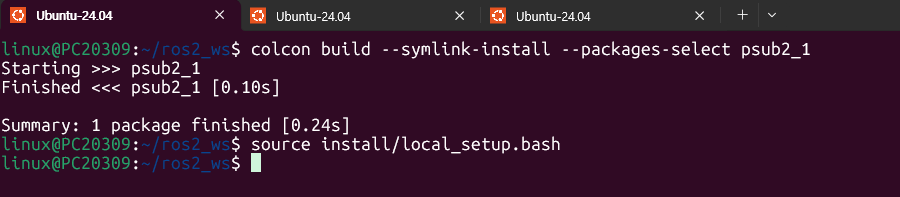

   `Finished <<< psub2_1`과 `1 package finished`가 출력되어 빌드가 성공했음을 보여준다.

2. 터미널 1에서 Publisher 노드 실행

   ```
   $ ros2 run psub2_1 pub
   ```

   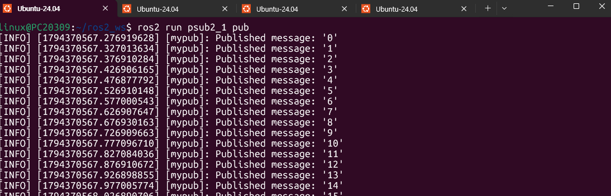

   `Published message`가 0부터 1씩 증가하며 출력된다. 로그 시각이 `567.276`, `567.327`, `567.376`, `567.426`으로 약 0.05초 간격이어서 50ms마다 발행되고 있음을 확인할 수 있다.

3. 터미널 2에서 Subscriber 노드 실행

   ```
   $ ros2 run psub2_1 sub
   ```

   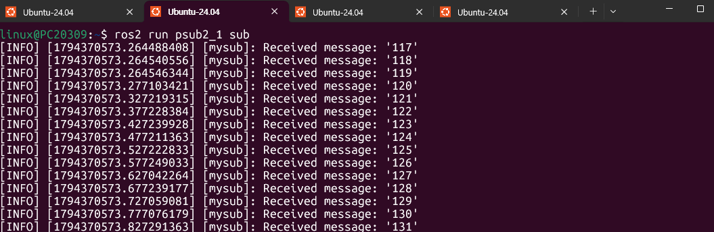

   `Received message`가 출력된다. `pub`을 먼저 켜 두고 나중에 `sub`를 실행해서 첫 값이 0이 아니라 117부터 시작한다. 이후 값은 pub이 발행한 값을 그대로 약 50ms 간격으로 수신한다.

4. 터미널 3에서 노드 연결 구조 확인

   ```
   $ rqt_graph
   ```

   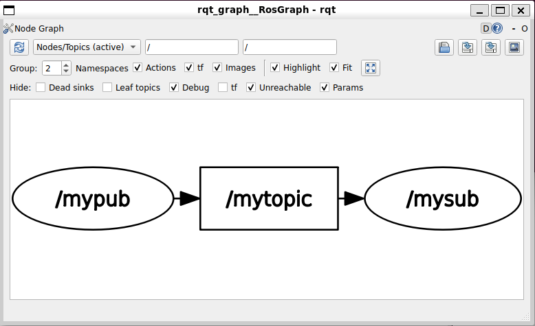

   `/mypub` 노드가 `/mytopic` 토픽으로 발행하고, `/mysub` 노드가 이를 구독하는 구조이다.

5. 터미널 4에서 ros2 명령어 실습

   ```
   $ ros2 pkg list | grep psub2_1
   $ ros2 node list
   $ ros2 topic list -t
   ```

   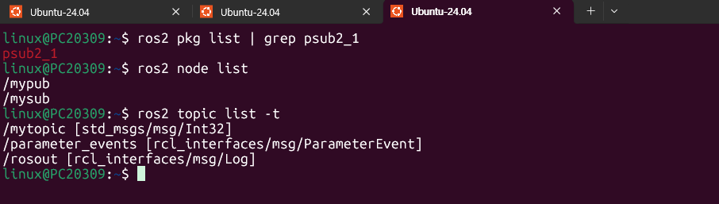

   ```
   $ ros2 topic echo /mytopic
   ```

   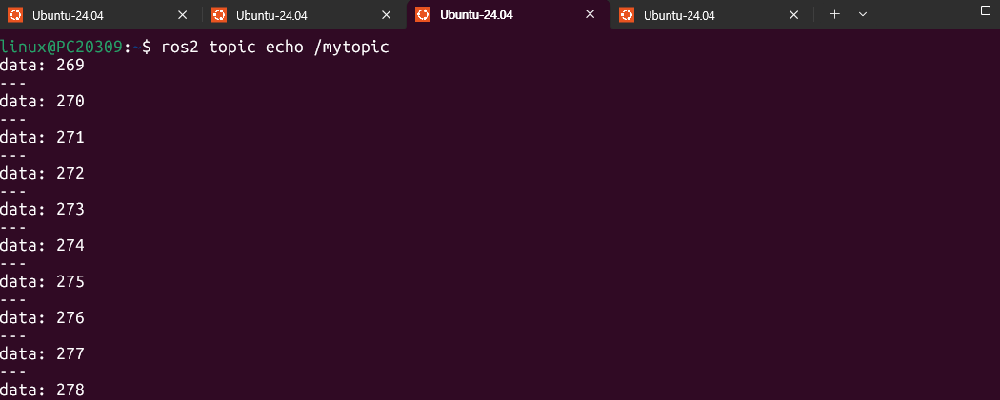

   ```
   $ ros2 topic hz /mytopic
   $ ros2 topic bw /mytopic
   ```

   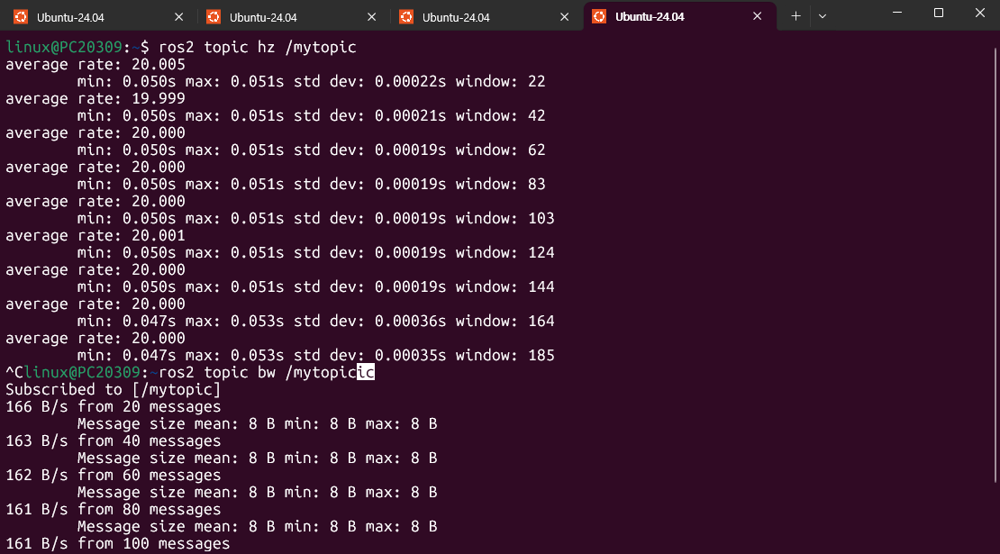

### 출력 결과 설명

- `ros2 pkg list | grep psub2_1`로 패키지 `psub2_1`이 등록되었음을 확인했다.
- `ros2 node list`에 `/mypub`, `/mysub` 두 노드가 나온다.
- `ros2 topic list -t`에 `/mytopic [std_msgs/msg/Int32]`가 나온다. 예제 1의 `String`이 `Int32`로 바뀐 것이다. `/parameter_events`와 `/rosout`은 노드가 있으면 자동으로 생기는 토픽이다.
- `ros2 topic echo /mytopic`은 메시지 하나가 `data: 269`처럼 출력되고 `---`로 구분된다. `String`이 아니라 `Int32`이므로 값에 따옴표가 붙지 않고 정수로 나온다.
- `ros2 topic hz /mytopic`은 `average rate`가 약 20.000으로, 50ms 주기가 초당 20번에 해당함을 보여준다. `min`/`max`는 0.050s, 0.051s 안팎이다.
- `ros2 topic bw /mytopic`은 메시지 크기가 8 B이고, 초당 약 161~166 B/s이다. 8 B × 20 = 160 B/s에 가까운 값이다. 8 B는 `int32` 4 B에 직렬화 헤더 4 B가 더해진 값으로 해석했다.

---

## 실습과제 2

**예제 1번을 수정하여 실수값 3개를 0으로 초기화하고 1초마다 1씩 증가시키면서 발행하고 구독하는 패키지 psub2-2를 작성하시오. 토픽 메시지 인터페이스는 geometry_msgs/msg/Vector3을 사용.**

패키지명은 같은 이유로 `psub2_2`이다. `Vector3`는 `float64` 필드 `x`, `y`, `z` 세 개로 이루어진 메시지이므로 실수값 3개를 하나의 메시지로 보낼 수 있다. 의존 패키지가 `std_msgs`에서 `geometry_msgs`로 바뀌므로 헤더 `#include`, `find_package`, `ament_target_dependencies`를 모두 고쳐야 한다.

### 소스파일과 코드 설명

#### include/psub2_2/pub.hpp

```cpp
#ifndef _PUB_HPP_
#define _PUB_HPP_
#include "rclcpp/rclcpp.hpp"
#include "geometry_msgs/msg/vector3.hpp"
#include <memory>
#include <chrono>
using namespace std::chrono_literals;
class Pub : public rclcpp::Node
{
private:
    rclcpp::TimerBase::SharedPtr timer_;
    rclcpp::Publisher<geometry_msgs::msg::Vector3>::SharedPtr pub_;
    geometry_msgs::msg::Vector3 count_;
    void publish_msg();
public:
    Pub();
};
#endif //_PUB_HPP_
```

과제 1과 다른 부분만 설명한다.

- `#include "geometry_msgs/msg/vector3.hpp"`: `Vector3` 메시지 인터페이스의 헤더이다.
- `rclcpp::Publisher<geometry_msgs::msg::Vector3>::SharedPtr pub_;`: 퍼블리셔의 메시지 자료형이 `Vector3`이다.
- `geometry_msgs::msg::Vector3 count_;`: 실수 3개를 한꺼번에 담는 카운터이다. `Vector3`는 `x`, `y`, `z` 세 필드를 가지므로 `count_` 하나로 실수 3개를 관리한다. 처음에는 `size_t count_;`를 그대로 두어서 `count_.x`에서 빌드 에러가 났고, 이 선언을 바꿔서 해결했다.

#### src/pub.cpp

```cpp
#include "psub2_2/pub.hpp"
Pub::Pub() : Node("mypub")
{
    count_.x = 0.0;
    count_.y = 0.0;
    count_.z = 0.0;
    auto qos_profile = rclcpp::QoS(rclcpp::KeepLast(10));
    pub_ = this->create_publisher<geometry_msgs::msg::Vector3>("mytopic", qos_profile);
    timer_ = this->create_wall_timer(1s, std::bind(&Pub::publish_msg, this));
}

void Pub::publish_msg()
{
    auto msg = geometry_msgs::msg::Vector3();
    msg.x = count_.x;
    msg.y = count_.y;
    msg.z = count_.z;
    RCLCPP_INFO(this->get_logger(), "Published message: x=%.1f, y=%.1f, z=%.1f",
                msg.x, msg.y, msg.z);
    pub_->publish(msg);
    count_.x += 1.0;
    count_.y += 1.0;
    count_.z += 1.0;
}
```

- `count_.x = 0.0;` 등 세 줄: 실수값 3개를 0으로 초기화한다. 메시지 구조체는 필드를 `(0.0, 0.0, 0.0)`처럼 한 번에 받는 생성자가 없어서 초기화 리스트에 쓸 수 없고, 생성자 본문에서 필드마다 대입한다.
- `create_wall_timer(1s, ...)`: 과제 조건대로 1초마다 호출한다.
- `msg.x = count_.x;` 등 세 줄: 현재 카운터 값을 메시지의 각 필드에 복사한다.
- `RCLCPP_INFO(...)`: `%.1f`는 소수점 한 자리까지 실수를 출력한다.
- `pub_->publish(msg);`: 값이 담긴 메시지를 발행한다.
- `count_.x += 1.0;` 등 세 줄: 발행한 뒤에 세 값을 각각 1씩 증가시킨다. `Vector3`에는 `++`나 `+=` 연산자가 없어서 필드마다 따로 증가시킨다. 발행 후에 증가시키므로 첫 메시지가 0.0이다.

#### include/psub2_2/sub.hpp

```cpp
#ifndef _SUB_HPP_
#define _SUB_HPP_
#include "rclcpp/rclcpp.hpp"
#include "geometry_msgs/msg/vector3.hpp"
#include <functional>
#include <memory>
using std::placeholders::_1;
class Sub : public rclcpp::Node
{
private:
    rclcpp::Subscription<geometry_msgs::msg::Vector3>::SharedPtr sub_;
    void subscribe_msg(const geometry_msgs::msg::Vector3::SharedPtr msg) const;
public:
    Sub();
};
#endif //_SUB_HPP_
```

과제 1과 달라진 것은 메시지 헤더와 `Subscription`, 콜백 인자의 자료형이 `geometry_msgs::msg::Vector3`로 바뀐 것뿐이다.

#### src/sub.cpp

```cpp
#include "psub2_2/sub.hpp"

void Sub::subscribe_msg(const geometry_msgs::msg::Vector3::SharedPtr msg) const
{
    RCLCPP_INFO(this->get_logger(), "Received message: x=%.1f, y=%.1f, z=%.1f",
                msg->x, msg->y, msg->z);
}

Sub::Sub() : Node("mysub")
{
    auto qos_profile = rclcpp::QoS(rclcpp::KeepLast(10));
    sub_ = this->create_subscription<geometry_msgs::msg::Vector3>("mytopic", qos_profile,
        std::bind(&Sub::subscribe_msg, this, _1));
}
```

- `msg->x, msg->y, msg->z`: 수신한 `Vector3` 메시지의 세 필드를 꺼내 출력한다.
- `create_subscription<geometry_msgs::msg::Vector3>`: 퍼블리셔와 같은 토픽(`mytopic`)을 같은 자료형으로 구독한다.

#### src/pmain.cpp, src/smain.cpp

과제 1과 같은 구조이고 `#include "psub2_2/pub.hpp"`, `#include "psub2_2/sub.hpp"`만 패키지명에 맞게 다르다.

```cpp
#include "psub2_2/pub.hpp"

int main(int argc, char * argv[])
{
    rclcpp::init(argc, argv);
    auto node = std::make_shared<Pub>();
    rclcpp::spin(node);
    rclcpp::shutdown();
    return 0;
}
```

#### CMakeLists.txt

```cmake
cmake_minimum_required(VERSION 3.16)
project(psub2_2)

# Default to C++14
if(NOT CMAKE_CXX_STANDARD)
  set(CMAKE_CXX_STANDARD 14)
endif()

if(CMAKE_COMPILER_IS_GNUCXX OR CMAKE_CXX_COMPILER_ID MATCHES "Clang")
  add_compile_options(-Wall -Wextra -Wpedantic)
endif()

# find dependencies
find_package(ament_cmake REQUIRED)
find_package(rclcpp REQUIRED)
find_package(geometry_msgs REQUIRED)

# 사용자 작성 헤더파일 경로 추가
include_directories(include)

#build
add_executable(pub src/pub.cpp src/pmain.cpp)
ament_target_dependencies(pub rclcpp geometry_msgs)

add_executable(sub src/sub.cpp src/smain.cpp)
ament_target_dependencies(sub rclcpp geometry_msgs)

# Install
install(TARGETS pub sub DESTINATION lib/${PROJECT_NAME})

ament_package()
```

과제 1의 `CMakeLists.txt`에서 `project(psub2_1)`을 `project(psub2_2)`로, `std_msgs`를 `geometry_msgs`로 바꾼 것이다. `find_package`와 `ament_target_dependencies` 두 곳 모두 바꿔야 한다.

### 실습 절차

1. 워크스페이스 루트에서 패키지를 빌드하고 환경을 적용한다.

   ```
   $ cd ~/ros2_ws
   $ colcon build --symlink-install --packages-select psub2_2
   $ source install/local_setup.bash
   ```

   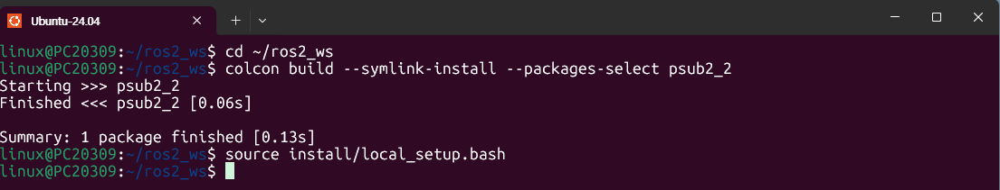

   `Finished <<< psub2_2`와 `1 package finished`가 출력되어 빌드가 성공했음을 보여준다.

2. 터미널 1에서 Publisher 노드 실행

   ```
   $ ros2 run psub2_2 pub
   ```

   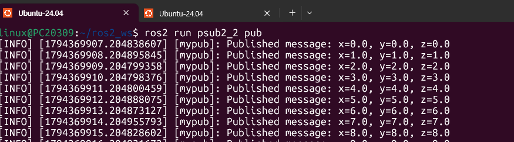

   `x`, `y`, `z`가 모두 0.0에서 시작해 1초마다 1.0씩 함께 증가한다. 로그 시각이 `907.204`, `908.204`, `909.204`로 1초 간격이다.

3. 터미널 2에서 Subscriber 노드 실행

   ```
   $ ros2 run psub2_2 sub
   ```

   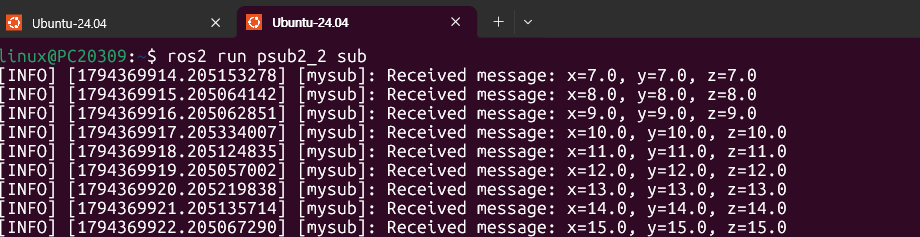

   `pub`이 이미 7.0까지 발행한 뒤에 `sub`를 켜서 7.0부터 수신한다. 세 값이 같이 증가하며 1초 간격으로 도착한다.

4. 터미널 3에서 노드 연결 구조 확인

   ```
   $ rqt_graph
   ```

   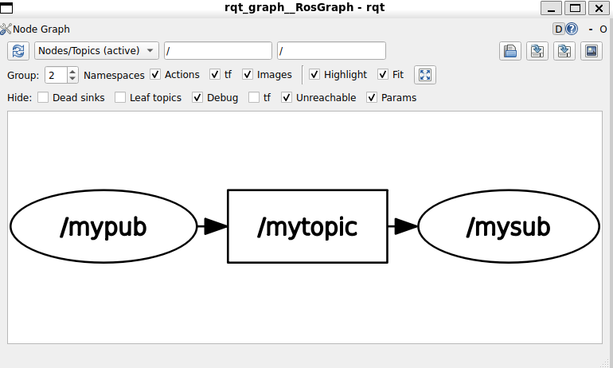

   `/mypub` → `/mytopic` → `/mysub` 구조이다.

5. 터미널 4에서 ros2 명령어 실습

   ```
   $ ros2 pkg list | grep psub2_2
   $ ros2 node list
   $ ros2 topic list -t
   ```

   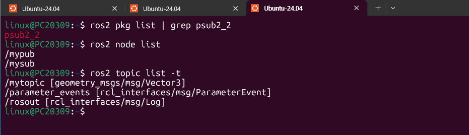

   ```
   $ ros2 topic echo /mytopic
   ```

   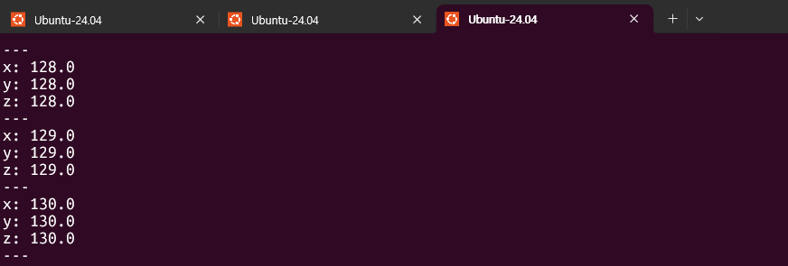

   ```
   $ ros2 topic hz /mytopic
   $ ros2 topic bw /mytopic
   ```

   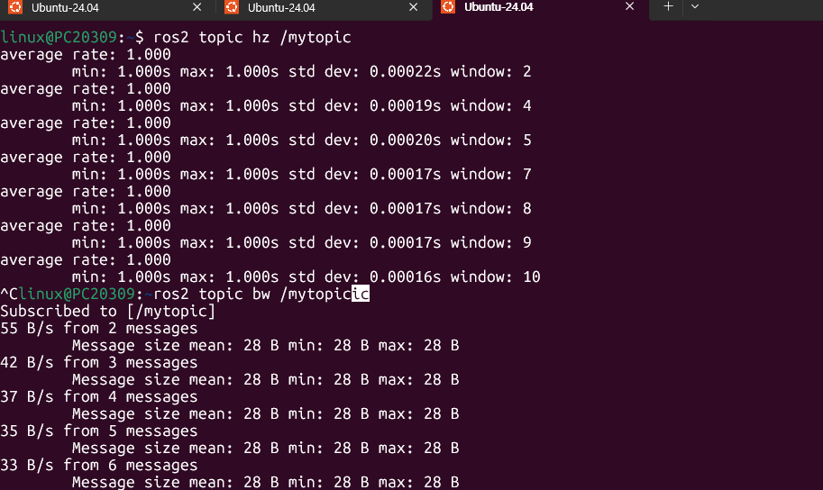

### 출력 결과 설명

- `ros2 topic list -t`에 `/mytopic [geometry_msgs/msg/Vector3]`가 나온다. 메시지 인터페이스가 `Vector3`로 바뀐 것을 확인할 수 있다.
- `ros2 topic echo /mytopic`은 `x`, `y`, `z`가 줄마다 출력되고 `---`로 메시지가 구분된다. 세 값이 128.0, 129.0, 130.0처럼 함께 증가한다.
- `ros2 topic hz /mytopic`은 `average rate`가 1.000으로, 1초 주기임을 확인한다.
- `ros2 topic bw /mytopic`은 메시지 크기가 28 B로 나온다. `float64` 3개가 24 B이고 직렬화 헤더 4 B가 더해진 값으로 해석했다(`Int32`가 4 B + 4 B = 8 B였던 것과 같은 계산이다).
